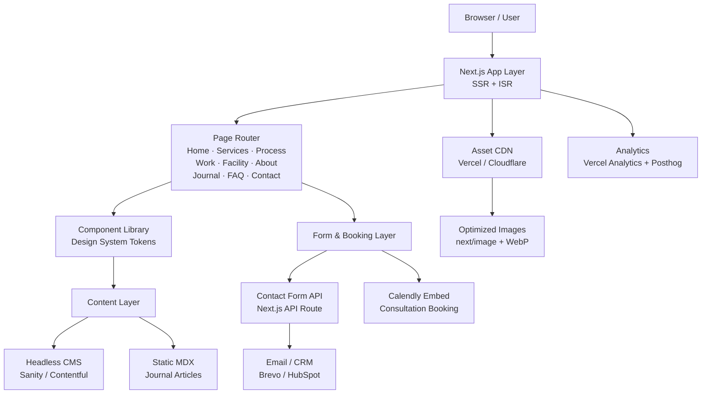
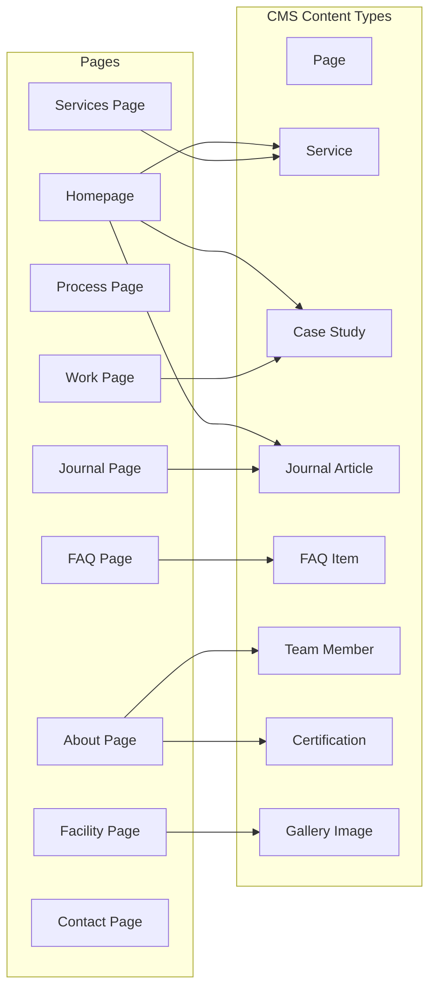
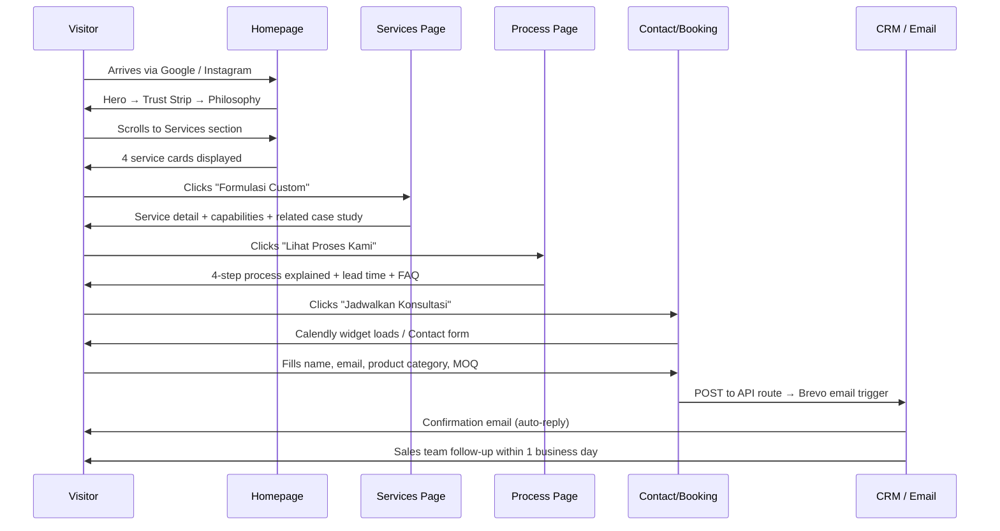
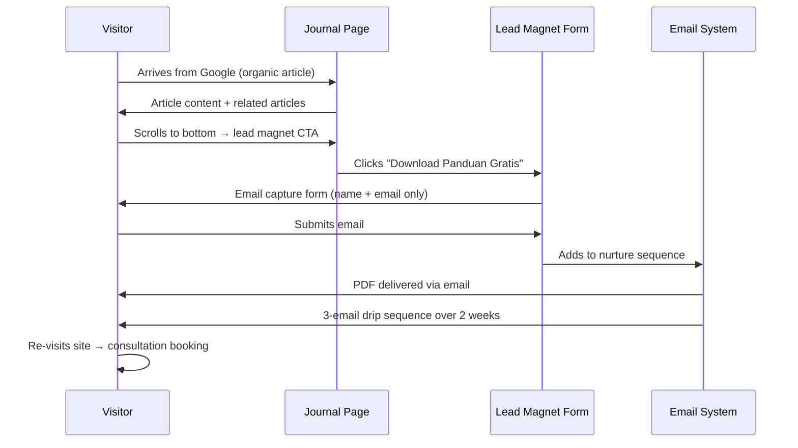

# Design Document: Haraka Erfi Website Redesign

> **Creative Direction**: Premium Cosmetic Manufacturing / Modern B2B / Editorial Corporate
> **Target Audience**: Brand owners, entrepreneurs, and businesses seeking a cosmetic manufacturing partner in Indonesia

---

## Overview

Haraka Erfi is a cosmetic and skincare contract manufacturing (maklon) company in Indonesia. This document defines the complete redesign strategy, design system, information architecture, and component specifications for rebuilding the website from scratch. The goal is a "Premium Cosmetic Manufacturing / Modern B2B / Editorial Corporate" digital presence that builds trust with brand owners, entrepreneurs, and businesses seeking a manufacturing partner — inspired by Aesop, The Ordinary, Typology, and Grown Alchemist, while remaining distinctly Haraka Erfi.

The document is structured in nine parts: Strategic Audit → Information Architecture → High-Level Design (system architecture, sitemap, component library, integrations) → Design System (tokens, typography, color, spacing, grid) → Visual & Creative Direction (photography, animation, mobile UX, conversion strategy) → Low-Level Component Specifications (pixel-exact button, form, nav, and section specs) → Data Models (CMS content types) → Sequence Flows (user journey diagrams) → Overall Creative Direction and Design North Star.

---

## Part I — Strategic Audit

### 1. Current UX/UI Problems

Based on analysis of typical Indonesian cosmetic contract manufacturing (maklon) websites, Haraka Erfi's current site likely suffers from the following:

**Navigation & Information Architecture**

- Flat, unstructured navigation with no clear hierarchy between pages
- Missing "Start Here" journey for first-time visitors unfamiliar with the maklon concept
- No progressive disclosure — everything crammed into one scroll or a shallow sitemap
- Internal search absent; finding specific services requires browsing

**Visual Design**

- Overuse of gradients, drop shadows, and border radii that read as "generic WordPress 2018"
- Inconsistent type scale — multiple font families used without system logic
- Hero sections with stock imagery (unrelated to actual facility or product)
- Neon or oversaturated accent colors that reduce premium perception
- No white space discipline; content packed to edges

**Trust & Credibility**

- Certifications (BPOM, CPKB, ISO 22716, Halal) buried or listed as plain text
- No visual evidence of facility quality (factory tour, lab photos, cleanroom imagery)
- Missing social proof: no client logos, testimonials, or case studies
- Generic "About Us" page with company history only, no team or faces

### 2. Content Hierarchy Problems

- Value proposition is buried — no clear answer to "Why Haraka Erfi over any other maklon?"
- Services listed as a flat feature list rather than outcome-oriented narratives
- Pricing, MOQ (Minimum Order Quantity), and process steps absent or vague
- No "How It Works" section to guide first-time brand owners through the process
- Blog/knowledge section either absent or filled with SEO-filler content

### 3. Visual Hierarchy Problems

- All elements compete equally for attention — no single dominant focal point per page
- Inconsistent heading weights create visual noise without aiding scanning
- CTA buttons not visually differentiated from secondary links
- Sections not separated by intentional rhythm; the page feels like a wall of content

### 4. Branding Problems

- Brand name "Haraka Erfi" has no visual identity that reflects its positioning
- No ownable color: site uses blue or green typical of Indonesian corporate/government sites
- Logomark appears to be a wordmark in a default system font
- Photography does not tell a brand story — generic stock or low-quality product shots
- No editorial voice; all copy is formal Bahasa Indonesia bureaucratic prose

### 5. Conversion Problems

- Single point of conversion: a generic "Contact Us" form
- No lead magnet: no consultation booking, no sample request, no formula inquiry tool
- No urgency or specificity in CTAs ("Hubungi Kami" with no context)
- Long quote process not explained — buyers leave without initiating
- No FAQ for the most common objections (MOQ, timeline, BPOM registration support)

### 6. Content to Preserve

- Company name and core business identity
- Certifications and regulatory standing (BPOM, CPKB, ISO 22716, Halal — these are trust anchors)
- Product category capabilities (skincare, haircare, bodycare, etc.)
- Geographic presence and facility location in Indonesia
- Years of experience / founding year
- Contact information, address, and operational area

### 7. Content to Rewrite

- All headlines: from feature-listing to benefit-driven, editorial copy
- About Us: reframe from "company profile" to brand philosophy and manufacturing ethos
- Service descriptions: from spec sheets to outcome narratives
- All CTAs: from generic verbs to specific, action-oriented micro-copy
- Footer: from dense legal block to structured, scannable information

### 8. Sections to Remove

- Rotating carousel banners (they undermine premium perception)
- Generic stock photo banners with overlaid gradient text
- Auto-playing background videos (if present)
- "Selamat Datang" welcome paragraphs (presumptuous and filler)
- Vestigial news/blog sections with infrequent, low-value posts
- Social media widget feeds embedded mid-page

### 9. Sections to Add

- **Manufacturing Philosophy** — editorial statement of craft and quality approach
- **How It Works** — 4-step visual process (Consult → Formulate → Produce → Launch)
- **Capabilities Matrix** — services, MOQ ranges, certifications, capacity at a glance
- **Client Journey** — case study or before/after of a brand built with Haraka Erfi
- **Facility Showcase** — curated photography of lab, production floor, quality control
- **Knowledge Hub** — high-value articles on starting a cosmetic brand in Indonesia
- **FAQ** — 10–15 specific, honest answers to the questions buyers actually ask
- **Consultation Booking** — embedded Calendly or custom form for qualified lead capture

---

## Part II — Information Architecture

### IA Design Decisions and Rationale

Before the final sitemap, the following structural questions required deliberate resolution:

**Decision 1 — "Products" as a top-level page**
The user's suggested structure included a `/products` page. After evaluation, a standalone `/products` page is **rejected** as a top-level route. Haraka Erfi is a manufacturing partner, not a product retailer — leading with "Products" positions the company as a catalog, which undermines the B2B service framing. Product categories (skincare, haircare, bodycare, makeup) are better served as **capability dimensions** within `/capabilities/manufacturing`. A separate `/products` route could confuse visitors into thinking they can purchase off-the-shelf products. Categories are surfaced as filterable content on the Capabilities page and referenced contextually on Services sub-pages.

**Decision 2 — "Certifications" as a top-level page**
A standalone `/certifications` page is **rejected** as top-level navigation. Certifications are a trust signal, not a destination — no prospective client will navigate to a Certifications page as their primary intent. Instead, certifications are: (a) shown in the Trust Strip on the homepage, (b) detailed on `/about/certifications` as a sub-page of About, and (c) referenced inline on Service pages where they add credibility. This keeps navigation clean and ensures certifications appear in context where they reinforce trust, not in isolation.

**Decision 3 — `/facility` as standalone vs. merged into `/about`**
`/facility` remains a **standalone page**. The manufacturing facility is Haraka Erfi's single most powerful trust asset — lab imagery, production floor, cleanroom. Merging it into `/about` would bury it under company narrative. A dedicated `/facility` URL also enables direct deep-linking from Google Images, Instagram, and "facility tour" search intent. The facility page serves a distinct audience segment (quality-conscious brand owners who want visual proof before committing). It is linked from the nav as a visual anchor, not categorized under About.

**Decision 4 — `/faq` as standalone vs. distributed**
The `/faq` page **remains standalone but is also distributed**. A dedicated FAQ URL serves SEO (FAQ schema markup) and provides a single destination for "Haraka Erfi FAQ" search queries. However, contextually relevant FAQ items are also rendered inline on `/process` (process and timeline questions) and on `/contact` (consultation and response time questions). The standalone `/faq` page aggregates all items and is linked from both Process and Contact as a "See all questions →" action.

**Decision 5 — `/capabilities` naming and structure**
The existing `/capabilities` route is **retained and expanded**, not renamed. The URL slug `/capabilities` already communicates the right intent for B2B discovery. The page is restructured to cover: manufacturing scope (product categories), technical capabilities (formulation types, active ingredients, delivery systems), certifications matrix, MOQ and capacity data, and facility technology. This is the page a procurement manager or brand owner visits when evaluating Haraka Erfi against competitors — it must read as a technical reference sheet, not marketing copy.

**Decision 6 — Navigation structure (top-level items)**
Five primary navigation items are defined: Services, Capabilities, Process, Portfolio, About. A sixth item — "Mulai Konsultasi" — appears as a gold CTA pill, not a standard nav link. This keeps the navigation minimal (no mega-menus) while covering all high-intent destinations. `/facility`, `/journal`, `/faq`, and `/contact` are accessible via footer navigation and contextual CTAs throughout the site, keeping the primary nav uncluttered.

---

### 10. Sitemap (Production-Ready)

#### Structural Decisions and Rationale

| #   | Decision                                              | Resolution                                 | Rationale                                                                                                                                                                                                                                                                                                                                                                                                           |
| --- | ----------------------------------------------------- | ------------------------------------------ | ------------------------------------------------------------------------------------------------------------------------------------------------------------------------------------------------------------------------------------------------------------------------------------------------------------------------------------------------------------------------------------------------------------------- |
| 1   | "Products" as top-level page                          | **Rejected — merged into `/capabilities`** | Haraka Erfi sells manufacturing services, not retail products. A `/products` route implies e-commerce and confuses visitor intent. Product categories (skincare, haircare, bodycare, makeup) are surfaced as filterable dimensions on the Capabilities page.                                                                                                                                                        |
| 2   | "Certifications" as standalone page                   | **Rejected — distributed**                 | Certifications are a trust signal, not a destination. They appear in the Trust Strip (homepage), as a module within `/capabilities`, and in full detail at `/tentang/sertifikasi`. Standalone cert pages produce thin content and do not serve any user intent.                                                                                                                                                     |
| 3   | `/fasilitas` as standalone vs. merged into `/tentang` | **Standalone retained**                    | The facility is Haraka Erfi's single most powerful trust asset. Merging it into About buries it. A dedicated URL enables direct deep-linking from Google Images, Instagram, and "pabrik kosmetik GMP Indonesia" search intent. Serves a distinct audience segment (quality-auditing prospects).                                                                                                                     |
| 4   | `/faq` standalone vs. distributed                     | **Standalone retained + distributed**      | A dedicated `/faq` URL enables FAQ schema markup and aggregates all objection-handling content. FAQ items are also embedded inline on `/proses` (timeline/process questions) and `/kontak` (consultation questions).                                                                                                                                                                                                |
| 5   | `/capabilities` rename for SEO                        | **Retained as `/capabilities`**            | The existing slug communicates correct intent for B2B discovery. Renaming to `/manufacturing` risks breaking any existing indexed URLs and does not resolve a clear SEO gap — "cosmetic manufacturing Indonesia" is best targeted via the homepage and service pages. `/capabilities` is restructured internally to cover product categories, formulation technology, MOQ/capacity data, and certifications matrix. |

---

#### Final Sitemap — Full Route Table

| Route                         | Purpose                                                      | Render Type | CMS Content Type                                           | Nav Priority |
| ----------------------------- | ------------------------------------------------------------ | ----------- | ---------------------------------------------------------- | ------------ |
| `/`                           | Homepage: value prop, credibility, conversion                | SSR         | Page (global settings), Service, CaseStudy, JournalArticle | —            |
| `/services`                   | Services hub: routing layer to service sub-pages             | Static      | Service (all)                                              | Primary nav  |
| `/services/formulasi-custom`  | Custom formula development detail                            | ISR         | Service (slug)                                             | Secondary    |
| `/services/private-label`     | Ready-to-brand formula detail                                | ISR         | Service (slug)                                             | Secondary    |
| `/services/kemasan`           | Packaging design & sourcing detail                           | ISR         | Service (slug)                                             | Secondary    |
| `/services/regulasi`          | BPOM & Halal registration support detail                     | ISR         | Service (slug)                                             | Secondary    |
| `/capabilities`               | Technical reference: scope, MOQ, certifications, capacity    | Static      | Certification (all), GalleryImage                          | Primary nav  |
| `/capabilities/manufacturing` | Filterable product category deep-dive                        | Static      | Certification, GalleryImage                                | Secondary    |
| `/proses`                     | How It Works: 4-step process, timeline, Calendly booking     | Static      | FAQItem (category: process)                                | Primary nav  |
| `/portofolio`                 | Portfolio hub: case study grid, filter by category           | ISR         | CaseStudy (all)                                            | Primary nav  |
| `/portofolio/[client-slug]`   | Individual case study: brand story, outcome                  | ISR         | CaseStudy (slug)                                           | Utility      |
| `/fasilitas`                  | Facility showcase: photography, area descriptions, visit CTA | Static      | GalleryImage (all)                                         | Footer nav   |
| `/tentang`                    | About hub: company story, philosophy, sub-page links         | Static      | TeamMember, Certification                                  | Primary nav  |
| `/tentang/filosofi`           | Manufacturing philosophy essay                               | Static      | Page (static content)                                      | Secondary    |
| `/tentang/tim`                | Team profiles                                                | Static      | TeamMember (all)                                           | Secondary    |
| `/tentang/sertifikasi`        | Full certification detail                                    | ISR         | Certification (all)                                        | Secondary    |
| `/jurnal`                     | Knowledge hub: article grid, lead magnet                     | ISR         | JournalArticle (all)                                       | Footer nav   |
| `/jurnal/[article-slug]`      | Individual article                                           | ISR         | JournalArticle (slug)                                      | Utility      |
| `/faq`                        | FAQ: objection handling, FAQ schema                          | Static      | FAQItem (all)                                              | Footer nav   |
| `/kontak`                     | Contact & Consultation: Calendly, form, map                  | Static      | —                                                          | CTA pill     |

**Render type definitions**:

- **SSR** (Server-Side Rendering): Fetches fresh data on every request. Used on Homepage to ensure stats and featured content are always current.
- **ISR** (Incremental Static Regeneration): Builds static HTML, revalidates on a schedule (recommended: 60s for case studies, 300s for journal). Best for CMS-driven content.
- **Static**: No dynamic data. Built at compile time. Used for pages where content is either hardcoded or managed via config files.

**URL language decision**: Primary routes use Indonesian slugs (`/proses`, `/portofolio`, `/fasilitas`, `/tentang`, `/jurnal`, `/kontak`) for local SEO relevance against Bahasa Indonesia queries. `/services` and `/capabilities` retain English slugs for B2B English-language search ("cosmetic contract manufacturing services Indonesia").

**Total unique routes**: 20 (6 top-level index pages + 4 service sub-pages + 2 capabilities sub-pages + 3 about sub-pages + 2 dynamic templates + `/faq` + `/kontak`)

**Dynamic route templates**: `/portofolio/[client-slug]` and `/jurnal/[article-slug]` are CMS-driven with ISR. `getStaticPaths` with `fallback: 'blocking'` for both.

### 11. Homepage Section Architecture (Production-Ready)

The homepage section order is determined by conversion logic. Each section has a single defined job. Sections are ordered by the trust-building sequence a first-time visitor needs: **identity → credibility → capability → service → differentiation → process → proof → categorization → social proof → conversion**.

| #      | Section Name                 | Background Token                    | Primary Content                                                                                                                                                      | Primary CTA                                                                   | Conversion Function                                              | Internal Links FROM This Section                                                                   |
| ------ | ---------------------------- | ----------------------------------- | -------------------------------------------------------------------------------------------------------------------------------------------------------------------- | ----------------------------------------------------------------------------- | ---------------------------------------------------------------- | -------------------------------------------------------------------------------------------------- |
| Nav    | Navigation Bar               | `cream-50` at 96% opacity (sticky)  | Logo · Services · Capabilities · Proses · Portofolio · Tentang                                                                                                       | "Mulai Konsultasi" (gold pill) → `/kontak`                                    | Persistent access layer                                          | All primary nav routes                                                                             |
| 1      | Hero                         | Full-bleed image + charcoal overlay | Eyebrow: "Cosmetic Contract Manufacturing · Indonesia" · H1: 2–3 lines DM Serif Display · Sub-headline: 1 benefit sentence                                           | "Mulai Konsultasi" (primary, ink)                                             | Anchor — communicates identity in ≤5s                            | `/kontak`, `/portofolio`                                                                           |
| 2      | Trust Strip                  | `cream-100`                         | Certification logos: BPOM · CPKB · ISO 22716 · Halal MUI · Separator · Stats: "Est. 20XX · 250+ Brand · 1.200+ Formula"                                              | —                                                                             | Immediate credibility — legitimacy before scroll decision        | `/tentang/sertifikasi` (on cert logo hover)                                                        |
| 3      | Capabilities Snapshot        | `cream-50`                          | 3-stat grid: MOQ / Kapasitas / Lead Time · Certification badge row below                                                                                             | "Lihat Kapabilitas Lengkap →"                                                 | Evaluation — give evaluators hard numbers immediately            | `/capabilities`                                                                                    |
| 4      | Services Overview            | `cream-100`                         | 4 service cards numbered 01–04: Formulasi Custom · Private Label · Kemasan · Regulasi · Each: title + 1-sentence + "Pelajari →"                                      | Each card → respective `/services/[slug]`                                     | Navigation — routes visitor to correct service sub-page          | `/services/formulasi-custom`, `/services/private-label`, `/services/kemasan`, `/services/regulasi` |
| 5      | Why Haraka Erfi              | `cream-50`                          | 3–4 differentiator items: short bold claim + 2-sentence elaboration · "Formulasi Tersertifikasi · Dukungan Regulasi Penuh · Kapasitas Fleksibel · Tim Berpengalaman" | —                                                                             | Evaluation — answers "why you vs. any other maklon?"             | `/tentang`, `/capabilities`                                                                        |
| 6      | How It Works                 | `charcoal` (inverted)               | 4-step horizontal rail: Konsultasi → Formulasi → Produksi → Peluncuran · Each step: number + label + 2–3 sentences                                                   | "Lihat Detail Proses →"                                                       | Confidence — reduces fear of the unknown                         | `/proses`                                                                                          |
| 7      | Facility Visual Storytelling | `ink-900` (near-black)              | Full-bleed asymmetric 3-image grid: lab · production floor · QC area                                                                                                 | "Lihat Fasilitas Kami →"                                                      | Trust — visual proof of scale and quality                        | `/fasilitas`                                                                                       |
| 8      | Product Categories           | `cream-50`                          | 4 category tiles: Skincare · Haircare · Bodycare · Makeup · Each: category name + brief capability note + CTA                                                        | Each tile → `/capabilities/manufacturing?category=[x]`                        | Navigation — visitor self-identifies by product type             | `/capabilities/manufacturing`                                                                      |
| 9      | Portfolio / Client Trust     | `cream-100`                         | 1 featured case study (editorial layout: image + story + key metric) · Optional: client logo strip below                                                             | "Lihat Semua Portofolio →"                                                    | Proof — shows Haraka Erfi has launched real, successful brands   | `/portofolio`, `/portofolio/[client-slug]`                                                         |
| 10     | Philosophy Statement         | `cream-50`                          | 2-column: editorial pull-quote (left) + ingredient/lab image (right) · Section label: "— Filosofi Kami"                                                              | "Tentang Kami →"                                                              | Engagement — emotional connection, differentiation from generics | `/tentang`, `/tentang/filosofi`                                                                    |
| 11     | From the Journal             | `cream-100`                         | 3 article cards: thumbnail + category + title + date                                                                                                                 | "Lihat Semua Artikel →"                                                       | Nurture — captures visitors not yet ready to consult             | `/jurnal`, `/jurnal/[article-slug]`                                                                |
| 12     | Final Consultation CTA Band  | `ink-900` (dark, full-width)        | Eyebrow: "— Siap Memulai?" · Headline: "Bangun Brand Anda Bersama Kami" · Sub: free consultation promise                                                             | "Jadwalkan Konsultasi" (cream bg) + "Hubungi via WhatsApp →" (gold text link) | Convert — final opportunity for visitors who scrolled full page  | `/kontak`, WhatsApp deep link                                                                      |
| Footer | Footer                       | `charcoal`                          | 4-column: Brand + social / Layanan / Perusahaan / Kontak · Bottom: copyright + privacy + terms                                                                       | —                                                                             | Utility + trust reinforcement                                    | All site routes                                                                                    |

**Section count**: 12 content sections + persistent nav + footer = 14 distinct zones per page load.

**Background alternation sequence** (prevents visual monotony):

```
Nav         → cream-50 (sticky, semi-transparent)
§1 Hero     → full-bleed image / charcoal overlay
§2 Trust    → cream-100
§3 Caps     → cream-50
§4 Services → cream-100
§5 Why Us   → cream-50
§6 Process  → charcoal (inverted)
§7 Facility → ink-900 (near-black)
§8 Products → cream-50
§9 Portfolio→ cream-100
§10 Philos. → cream-50
§11 Journal → cream-100
§12 CTA     → ink-900 (dark)
Footer      → charcoal
```

**Changes from previous §11 draft**:

- Philosophy Statement moved from position 3 to position 10 — credibility and capability content takes priority over editorial brand content for first-time visitors
- Capabilities Snapshot promoted to position 3 (immediately after Trust Strip) to give evaluators hard numbers before they commit to reading further
- "Why Haraka Erfi" added as §5 (new section, not in previous draft) — directly addresses competitive differentiation after services are introduced
- Product Categories added as §8 (new section, not in previous draft) — allows visitor self-segmentation by product type before reaching portfolio
- Section numbers re-ordered throughout to reflect the new priority sequence

---

---

## Part III — High-Level Design

## Architecture

_See detailed breakdown below in §12–16._

### 12. System Architecture

The website is a content-driven, server-rendered marketing site with a headless CMS layer for editorial content.



**Technology Stack Recommendation**

- **Framework**: Next.js 14+ (App Router, ISR for CMS pages)
- **Styling**: Tailwind CSS v4 with design token CSS variables
- **CMS**: Sanity.io (structured content, image pipeline, bilingual support)
- **Hosting**: Vercel (edge CDN, preview deployments)
- **Forms**: Custom Next.js API route → Brevo (transactional email)
- **Booking**: Calendly embedded widget (consultation scheduling)
- **Analytics**: Vercel Analytics + PostHog (session replay, heatmaps)
- **i18n**: next-intl (Indonesian primary, English secondary)

### 13. Responsive Breakpoints

```
Token Name      Min Width    Max Width    Usage
──────────────────────────────────────────────────────────
xs              0px          479px        Mobile portrait
sm              480px        767px        Mobile landscape
md              768px        1023px       Tablet
lg              1024px       1279px       Desktop
xl              1280px       1535px       Wide desktop
2xl             1536px       ∞            Ultra-wide (max-width container applied)
```

- **Container max-width**: `1280px` centered, padding `24px` mobile / `48px` tablet / `80px` desktop
- **Fluid type**: CSS `clamp()` used for all display and heading sizes
- **Grid**: 4-column mobile, 8-column tablet, 12-column desktop

### 14. Page Map & Content Types



## Components and Interfaces

_Detailed component specifications are in Part VI (§26–29). The component library overview is in §15._

### 15. Component Library Overview

The component library is organized in four layers:

```
Layer 0 — Tokens
  colors · typography · spacing · radius · shadows · motion

Layer 1 — Primitives
  Text · Button · Link · Icon · Divider · Image · Badge

Layer 2 — Compositions
  Card · ServiceCard · StatBlock · QuoteBlock
  StepItem · CertificationBadge · TeamCard · ArticleCard

Layer 3 — Sections / Templates
  NavBar · HeroSection · PhilosophySection · ServicesGrid
  HowItWorks · CapabilitiesSnapshot · FacilityGrid
  ClientStoryFeature · JournalStrip · CTABand · Footer
  ArticleLayout · ServiceDetailLayout · CaseStudyLayout
```

**Component design principles**:

- No component accepts inline style overrides from parents — all variation through props
- Every component has a default, hover, and focus state defined
- Dark surface variants available for invert sections (white text on dark canvas)
- All interactive elements meet WCAG 2.2 AA contrast (4.5:1 for text, 3:1 for UI elements)

### 16. Integration Points

| Integration        | Purpose                                        | Method                                    |
| ------------------ | ---------------------------------------------- | ----------------------------------------- |
| Sanity.io          | CMS for pages, services, case studies, journal | GROQ API → `next-sanity`                  |
| Calendly           | Consultation booking widget                    | Script embed + Calendly Popup Widget      |
| Brevo (Sendinblue) | Form submission → transactional email          | REST API via Next.js API route            |
| Google Tag Manager | Tag container for analytics and pixels         | `<Script>` component in `layout.tsx`      |
| PostHog            | Session recording, heatmaps, feature flags     | PostHog JS SDK                            |
| Vercel Analytics   | Core Web Vitals, page views                    | `@vercel/analytics` component             |
| WhatsApp Business  | Direct inquiry via floating button             | `wa.me` deep link with pre-filled message |
| Google Maps        | Facility location embed on Contact page        | `@vis.gl/react-google-maps`               |

---

## Part IV — Design System

### 17. Design Token System

All tokens are defined as CSS custom properties in a single `:root` block and referenced by semantic aliases throughout the system. Raw values are never used directly in components.

```
Structure:
  Raw Tokens     →  Semantic Tokens    →  Component Tokens
  (--color-*)       (--color-text-*)      (--btn-primary-bg)
  (--space-*)       (--space-section-*)
  (--font-*)        (--type-heading-*)
```

#### Design Token Map

```css
/* ================================================
   COLOR — Raw Palette
   ================================================ */
--color-cream-50: #fdfcf7; /* near-white page canvas */
--color-cream-100: #f9f6ed; /* section background alt */
--color-cream-200: #f0ead8; /* subtle surface, hover bg */
--color-ink-900: #1a1917; /* primary text */
--color-ink-700: #3d3a35; /* secondary text */
--color-ink-500: #6b6560; /* muted / caption text */
--color-ink-300: #b5b0a8; /* placeholder / disabled */
--color-ink-100: #e8e4de; /* hairline border */
--color-charcoal: #2b2926; /* dark surface bg */
--color-bone: #d4cfc6; /* mid-tone neutral */
--color-gold-warm: #c9a96e; /* primary accent */
--color-gold-deep: #9e7a3d; /* accent hover / pressed */
--color-gold-pale: #ede0c4; /* accent tint surface */
--color-white: #ffffff; /* pure white (inverted text) */
--color-error: #c0392b; /* form error */
--color-success: #2d6a4f; /* form success */

/* ================================================
   COLOR — Semantic Aliases
   ================================================ */
--color-bg-page: var(--color-cream-50);
--color-bg-alt: var(--color-cream-100);
--color-bg-surface: var(--color-cream-200);
--color-bg-dark: var(--color-charcoal);
--color-text-primary: var(--color-ink-900);
--color-text-secondary: var(--color-ink-700);
--color-text-muted: var(--color-ink-500);
--color-text-disabled: var(--color-ink-300);
--color-text-inverted: var(--color-white);
--color-border: var(--color-ink-100);
--color-border-strong: var(--color-bone);
--color-accent: var(--color-gold-warm);
--color-accent-hover: var(--color-gold-deep);
--color-accent-tint: var(--color-gold-pale);
```

### 18. Typography System

#### Font Selection

| Role               | Typeface             | Rationale                                                                            |
| ------------------ | -------------------- | ------------------------------------------------------------------------------------ |
| Display / Headline | **DM Serif Display** | High contrast, editorial weight, evokes premium print without being cold             |
| Body / UI          | **DM Sans**          | Same design family — effortlessly harmonious; modern grotesque, excellent legibility |
| Mono (data/labels) | **DM Mono**          | Consistent family; used for certification codes, spec tables                         |

All three fonts are in the same DM superfamily (Colophon Foundry / Google Fonts), ensuring optical coherence without manual tuning.

**Google Fonts import**:

```css
@import url("https://fonts.googleapis.com/css2?family=DM+Serif+Display:ital@0;1&family=DM+Sans:ital,opsz,wght@0,9..40,300;0,9..40,400;0,9..40,500;0,9..40,600;1,9..40,400&family=DM+Mono:wght@400;500&display=swap");
```

#### Type Scale (px / rem)

All values based on `16px` base. Line heights and tracking shown per role.

```
Token               Size          Line Height   Letter Spacing   Font
─────────────────────────────────────────────────────────────────────────
--type-display-xl   72px / 4.5rem    1.0           -0.03em     DM Serif Display
--type-display-lg   56px / 3.5rem    1.05          -0.02em     DM Serif Display
--type-display-md   44px / 2.75rem   1.1           -0.02em     DM Serif Display
--type-heading-xl   36px / 2.25rem   1.15          -0.015em    DM Serif Display
--type-heading-lg   28px / 1.75rem   1.2           -0.01em     DM Sans 600
--type-heading-md   22px / 1.375rem  1.3           -0.01em     DM Sans 600
--type-heading-sm   18px / 1.125rem  1.4           -0.005em    DM Sans 600
--type-body-lg      18px / 1.125rem  1.65          0           DM Sans 400
--type-body-md      16px / 1rem      1.7           0           DM Sans 400
--type-body-sm      14px / 0.875rem  1.6           0.01em      DM Sans 400
--type-label        12px / 0.75rem   1.5           0.08em      DM Sans 500 uppercase
--type-caption      11px / 0.6875rem 1.5           0.05em      DM Sans 400
--type-mono-sm      13px / 0.8125rem 1.5           0.02em      DM Mono 400
```

**Fluid type (CSS clamp examples)**:

```css
--type-display-xl: clamp(2.5rem, 5vw + 1rem, 4.5rem);
--type-display-lg: clamp(2rem, 4vw + 0.75rem, 3.5rem);
--type-display-md: clamp(1.75rem, 3vw + 0.5rem, 2.75rem);
--type-heading-xl: clamp(1.5rem, 2.5vw + 0.5rem, 2.25rem);
```

### 19. Color System (Complete)

#### Primary Palette — "Cream & Ink"

| Token               | Hex       | Usage                              |
| ------------------- | --------- | ---------------------------------- |
| `--color-cream-50`  | `#fdfcf7` | Page canvas (primary background)   |
| `--color-cream-100` | `#f9f6ed` | Section alternate background       |
| `--color-cream-200` | `#f0ead8` | Hover surfaces, subtle fills       |
| `--color-ink-900`   | `#1a1917` | Primary text, headings             |
| `--color-ink-700`   | `#3d3a35` | Body text, secondary headings      |
| `--color-ink-500`   | `#6b6560` | Muted text, captions               |
| `--color-ink-300`   | `#b5b0a8` | Disabled states, placeholder       |
| `--color-ink-100`   | `#e8e4de` | Hairlines, dividers, input borders |
| `--color-charcoal`  | `#2b2926` | Dark section background            |

#### Accent Palette — "Warm Gold"

| Token               | Hex       | Usage                                      |
| ------------------- | --------- | ------------------------------------------ |
| `--color-gold-warm` | `#c9a96e` | Primary accent, CTA borders, active states |
| `--color-gold-deep` | `#9e7a3d` | Hover, pressed, active accent              |
| `--color-gold-pale` | `#ede0c4` | Accent tint backgrounds, tag fills         |

**Design rationale**: Warm gold replaces the cool blues common in Indonesian corporate sites. It connects to natural ingredients, premium cosmetic packaging, and laboratory equipment warmth — without reading as "luxury jewelry." It is deliberately desaturated enough to remain professional.

#### Functional Colors

| Token             | Hex       | Usage                       |
| ----------------- | --------- | --------------------------- |
| `--color-error`   | `#c0392b` | Form validation errors      |
| `--color-success` | `#2d6a4f` | Form success, confirmation  |
| `--color-warning` | `#9a6700` | Alerts, information banners |

#### Color Usage Rules

1. **No gradients** — flat fills only throughout the design system
2. **No drop shadows** — depth communicated through whitespace and border contrast
3. **No rounded corners** on editorial elements (cards, sections, images) — `border-radius: 0` is default; `2px` allowed on pill badges only
4. **Background alternation**: `cream-50` → `cream-100` → `charcoal` (inverted) — never two adjacent dark sections
5. **Accent usage**: gold appears maximum twice per viewport — once for primary CTA, once for a decorative accent element

### 20. Spacing System

Based on a strict **8px grid** with a secondary 4px micro-grid for inline text adjustments.

```
Token           Value    Usage
────────────────────────────────────────────────────────────
--space-1        4px     Icon padding, tight inline gaps
--space-2        8px     Button inner padding (vertical), badge padding
--space-3       12px     Input internal padding (vertical)
--space-4       16px     Default paragraph spacing, small gap
--space-5       20px     Component internal padding
--space-6       24px     Card padding (mobile), grid gap (mobile)
--space-8       32px     Card padding (desktop), section element gap
--space-10      40px     Sub-section spacing
--space-12      48px     Component-to-component gap
--space-16      64px     Section padding top/bottom (mobile)
--space-20      80px     Section padding top/bottom (tablet)
--space-24      96px     Section padding top/bottom (desktop)
--space-32     128px     Hero section extra breathing room
--space-40     160px     Large editorial gap / visual silence
--space-48     192px     Full-bleed section vertical padding
```

**Section rhythm**:

- Every page section uses a consistent vertical padding of `--space-24` (96px) on desktop, `--space-16` (64px) on mobile
- Section separator: `1px` hairline in `--color-ink-100` OR pure whitespace (no decorative dividers)
- Maximum content line length: `70ch` for body text, `52ch` for display text

### 21. Layout Grid

```
Breakpoint   Columns   Gutter    Column Width   Side Margin
──────────────────────────────────────────────────────────────
xs (≥0)        4         16px      auto           24px
sm (≥480)      4         20px      auto           32px
md (≥768)      8         24px      auto           48px
lg (≥1024)    12         32px      auto           64px
xl (≥1280)    12         40px      auto           80px
```

**Max content container**: `1280px`  
**Max editorial text container**: `760px` (article, philosophy, case study body)  
**Max card grid container**: `1120px`

---

## Part V — Visual & Creative Direction

### 22. Image & Art Direction

**Photography style**:

- **Facility imagery**: Shot in natural light or controlled diffused studio light. No harsh artificial top-lights. Angles suggest precision and cleanliness — steel surfaces, pipettes, measured glass containers.
- **Ingredient imagery**: Overhead macro shots on warm-white or cream background. Raw materials (botanical extracts, powders) photographed at high magnification to communicate science.
- **Process imagery**: Human hands in lab context — pipetting, QC inspection, label examination. Faces should feel expert, not salesy.
- **No stock photography** — all images must be original or custom shot at the Haraka Erfi facility.

**Color grading**:

- Warm color temperature: 5000–5500K
- Slightly desaturated: -10 to -15 saturation in Lightroom/Capture One
- Gentle warm lift in shadows (avoid cold, blue-toned industrial photography)
- No lens flares, no bokeh excess — sharp, informative compositions

**Aspect ratios**:

- Hero full-bleed: `16:9` (desktop) / `4:3` (tablet) / `1:1` (mobile)
- Card thumbnail: `3:2`
- Team portraits: `1:1` (square, grayscale or muted color)
- Facility gallery: Mix of `16:9` and `4:3` in masonry grid

**Whitespace as art direction**:

- Never crop an image to the edges of its container unless it is a full-bleed hero
- Allow breathing room between image and adjacent text — minimum `--space-8` (32px)

### 23. Animation Principles

**Philosophy**: Motion should reveal, not impress. Every animation has a functional justification.

```
Type                Duration    Easing                  Notes
──────────────────────────────────────────────────────────────────────────
Fade in (appear)    400ms       ease-out (0,0,0.3,1)    Page load, lazy
Slide up (appear)   500ms       cubic-bezier(0,0,0.2,1) Section entrance
Hover (button)      150ms       ease                    Color/border change
Hover (card)        200ms       ease                    Subtle Y translate -2px
Focus ring          100ms       ease                    Keyboard nav
Navigation open     250ms       ease-in-out             Mobile menu
Page transition     200ms       ease-in-out             Opacity fade
Scroll reveal       600ms       cubic-bezier(0,0,0.2,1) Intersection Observer
```

**Animation rules**:

1. **No entrance animations on above-the-fold content** — hero must be instant
2. **Respect `prefers-reduced-motion`** — all motion wraps `@media (prefers-reduced-motion: reduce)` disable
3. **No parallax scrolling** — it fights the editorial stillness of the brand
4. **No looping animations** on the page unless triggered by user interaction
5. **Scroll reveal** uses a single variant: `opacity: 0 → 1` + `translateY: 16px → 0`
6. **Stagger**: When multiple items animate in together (e.g., service cards), stagger by `80ms` per item

### 24. Mobile UX Strategy

**Core approach**: Mobile-first composition, not mobile-adapted. Every layout decision starts from the 4-column mobile grid and scales up.

**Navigation**:

- Desktop: Full horizontal nav bar with logo left, links center, CTA pill right
- Mobile: Logo left + hamburger right. Tap opens a full-screen overlay menu with large link type (28px), white on charcoal. Closes with × or swipe down.
- Sticky on scroll with `backdrop-filter: blur(12px)` and slight cream background opacity (no harsh solid header)

**Section adaptations**:

- Hero: Full viewport height mobile with image behind text + dark overlay (40% opacity charcoal). Text stack: label → headline → sub → CTA
- Services grid: 1 column mobile → 2 column tablet → 4 column desktop
- How It Works: Vertical step list mobile → Horizontal step rail desktop
- Capabilities Snapshot: 1 stat per row mobile → 3-column desktop
- Facility gallery: Single column scroll mobile → Masonry 3-column desktop
- Client Story: Full-width stacked mobile → Split 50/50 desktop

**Touch targets**: Minimum `44px × 44px` for all tappable elements (WCAG 2.5.8)

**Performance**:

- Images: `next/image` with `priority` on above-fold, `lazy` on all others, WebP + AVIF
- LCP target: < 2.5s on mobile 4G
- CLS: 0 (all images have defined width/height; no layout shift from fonts via `font-display: optional`)
- No JavaScript required to see core content (SSR)

**WhatsApp button**:

- Floating action button, bottom-right, mobile only
- Icon: WhatsApp logo in `--color-charcoal` on `--color-gold-warm` background
- Tap opens `wa.me/62XXXXXXXXXX?text=Halo+Haraka+Erfi%2C+saya+tertarik+dengan+layanan+maklon`
- Appears after 3 seconds on page, hides when contact form is in viewport

### 25. Conversion Strategy

**Lead capture funnel**:

```
Awareness (traffic arrives)
        ↓
Interest (philosophy, facility, capabilities)
        ↓
Consideration (services detail, case studies, FAQ)
        ↓
Intent (consultation CTA, WhatsApp, contact form)
        ↓
Qualified Lead (email + Calendly booking → CRM)
```

**Conversion touchpoints by page**:

| Page     | Primary CTA                                   | Secondary CTA                              |
| -------- | --------------------------------------------- | ------------------------------------------ |
| Homepage | "Begin a Consultation" (scroll-to booking)    | "Explore Our Services"                     |
| Services | "Request a Formula Brief" (form)              | "View Capabilities"                        |
| Process  | "Start Your Journey" (Calendly)               | "Download Process Guide" (lead magnet PDF) |
| Work     | "Build Your Brand With Us"                    | "Read Full Case Study"                     |
| Facility | "Book a Facility Visit"                       | "See Certifications"                       |
| FAQ      | "Still have questions? Talk to us" (WhatsApp) | "View All Services"                        |
| Contact  | "Schedule a Free Consultation" (Calendly)     | WhatsApp                                   |

**Lead magnet**: "Panduan Lengkap Memulai Brand Kosmetik di Indonesia" — a downloadable PDF guide (email gate). Positioned on the Process page and Journal.

**Trust accelerators**:

- Certification logos visible in the first screen (trust strip below hero)
- Client count and brands launched counter (animated number on scroll)
- Response time promise: "Kami merespons dalam 1 hari kerja"
- Featured in / partner logos (if applicable)

---

## Part VI — Low-Level Component Specifications

### 26. Button & CTA Specifications

#### Primary Button — "Filled"

```
Background:       var(--color-ink-900)
Text color:       var(--color-cream-50)
Border:           none
Border-radius:    0px (hard edge)
Padding:          14px 28px (--space-3 --space-8 approx)
Font:             DM Sans 500, 14px, letter-spacing: 0.05em, UPPERCASE
Height:           48px
Min-width:        160px

Hover:
  Background:     var(--color-charcoal)
  Transition:     background 150ms ease

Focus:
  Outline:        2px solid var(--color-gold-warm)
  Outline-offset: 2px

Disabled:
  Background:     var(--color-ink-300)
  Cursor:         not-allowed
```

#### Secondary Button — "Outlined"

```
Background:       transparent
Text color:       var(--color-ink-900)
Border:           1px solid var(--color-ink-900)
Border-radius:    0px
Padding:          13px 27px (1px border accounts for 1px)
Font:             DM Sans 500, 14px, letter-spacing: 0.05em, UPPERCASE
Height:           48px

Hover:
  Background:     var(--color-cream-200)
  Transition:     background 150ms ease

Focus:
  Outline:        2px solid var(--color-gold-warm)
  Outline-offset: 2px
```

#### CTA Pill (Navigation)

```
Background:       var(--color-gold-warm)
Text color:       var(--color-ink-900)
Border:           none
Border-radius:    0px
Padding:          10px 20px
Font:             DM Sans 500, 13px, letter-spacing: 0.06em, UPPERCASE
Height:           40px

Hover:
  Background:     var(--color-gold-deep)
  Color:          var(--color-cream-50)
  Transition:     all 150ms ease
```

#### Text Link

```
Color:            var(--color-ink-900)
Text-decoration:  underline (1px, offset 3px)
Font:             DM Sans 400
Underline-color:  var(--color-ink-300)

Hover:
  Underline-color: var(--color-gold-warm)
  Transition:      text-decoration-color 150ms ease
```

### 27. Form Field Specifications

#### Text Input

```
Background:         var(--color-cream-50)
Border:             1px solid var(--color-ink-100)
Border-radius:      0px
Padding:            12px 16px
Font:               DM Sans 400, 16px
Color:              var(--color-ink-900)
Height:             48px
Width:              100% (fluid)

Label:
  Font:             DM Sans 500, 12px, UPPERCASE, letter-spacing: 0.08em
  Color:            var(--color-ink-700)
  Margin-bottom:    6px

Placeholder:
  Color:            var(--color-ink-300)

Focus:
  Border:           1px solid var(--color-ink-900)
  Outline:          none (border handles focus indicator)
  Box-shadow:       none

Error state:
  Border:           1px solid var(--color-error)

Error message:
  Font:             DM Sans 400, 12px
  Color:            var(--color-error)
  Margin-top:       4px
```

#### Textarea

```
Same as Text Input except:
  Height:           auto (min 120px)
  Resize:           vertical only
  Padding:          12px 16px
```

#### Select / Dropdown

```
Same as Text Input with:
  Appearance:       none (custom chevron via background-image SVG)
  Padding-right:    40px (space for chevron icon)
  Cursor:           pointer
```

#### Form Layout

```
Form container max-width:   640px
Field stack gap:            24px (--space-6)
Field label to input gap:   6px
Submit button margin-top:   32px (--space-8)
```

#### Contact Form — Fields Required

```
1. Nama Lengkap         (text input, required)
2. Email                (email input, required)
3. Nomor WhatsApp       (tel input, optional)
4. Nama Brand / Perusahaan (text input, optional)
5. Kategori Produk      (select: Skincare / Haircare / Bodycare / Makeup / Lainnya)
6. Target MOQ           (select: < 500 pcs / 500–2000 pcs / > 2000 pcs)
7. Pesan / Pertanyaan   (textarea, required)
8. Bagaimana Anda menemukan kami? (select: Google / Referral / Instagram / Event / Lainnya)
Submit: "Kirim Pesan" (Primary Button)
```

### 28. Navigation Bar Specification

```
Height:             72px desktop / 64px mobile
Background:         var(--color-cream-50) at opacity 0.96
Backdrop-filter:    blur(8px) (frosted when scrolled)
Border-bottom:      1px solid var(--color-ink-100) (appears on scroll)
Position:           sticky top 0, z-index: 100
Transition:         border-color 200ms ease, background 200ms ease

LOGO (left):
  Height:           32px
  Width:            auto
  Margin-left:      --space-8 (desktop), --space-6 (mobile)

NAV LINKS (center, desktop only):
  Font:             DM Sans 400, 14px, letter-spacing: 0.02em
  Color:            var(--color-ink-700)
  Gap between links: 40px
  Hover color:      var(--color-ink-900)
  Active indicator: 1px underline in var(--color-gold-warm), offset 4px

CTA PILL (right):
  "Mulai Konsultasi" — CTA Pill component (see §26)
  Margin-right:     --space-8 (desktop), --space-6 (mobile)

MOBILE HAMBURGER:
  Size:             24px × 18px (3 lines)
  Line color:       var(--color-ink-900)
  Line height:      2px
  Gap:              5px

MOBILE MENU OVERLAY:
  Background:       var(--color-charcoal)
  Width:            100vw
  Height:           100vh
  Padding:          32px
  Links:
    Font:           DM Serif Display, 32px
    Color:          var(--color-cream-50)
    Gap:            32px
  Close button:
    Position:       top-right
    Icon:           × (24px)
    Color:          var(--color-cream-50)
  Animation:        translateX(100%) → translateX(0), 250ms ease-in-out
```

### 29. Section-by-Section Homepage Layout Specs

#### Section 1 — Hero

```
Height:             100vh (min 600px, max 900px)
Background:         Full-bleed facility or ingredient image
Overlay:            linear-gradient(to right, rgba(26,25,23,0.75) 0%, rgba(26,25,23,0.2) 100%)

Content layout (left-aligned, max-width 600px, left offset 80px desktop):

  EYEBROW LABEL:
    Text:           "Cosmetic Contract Manufacturing · Indonesia"
    Font:           DM Mono 400, 12px, letter-spacing: 0.08em
    Color:          var(--color-gold-warm)
    Margin-bottom:  --space-4 (16px)

  HEADLINE:
    Text:           [2–3 lines of DM Serif Display in display-xl]
    Font:           DM Serif Display, clamp(2.5rem, 5vw + 1rem, 4.5rem)
    Color:          var(--color-cream-50)
    Line-height:    1.0
    Max-width:      560px
    Margin-bottom:  --space-6 (24px)

  SUB-HEADLINE:
    Text:           [1 sentence, benefit-led]
    Font:           DM Sans 400, 18px
    Color:          rgba(253, 252, 247, 0.8)
    Margin-bottom:  --space-8 (32px)

  CTA GROUP (flex row, gap 16px):
    1. Primary Button: "Mulai Konsultasi"
    2. Text Link with arrow: "Lihat Portofolio →"
       Color:       var(--color-cream-50)
       Underline:   var(--color-gold-warm)

SCROLL INDICATOR (bottom center):
  Chevron down icon, 20px, animated bounce, color: cream-50 at 60% opacity
  Hides after 3s or on first scroll
```

#### Section 2 — Trust Strip

```
Background:         var(--color-cream-100)
Height:             80px (desktop) / auto (mobile, wraps to 2 rows)
Border-top:         1px solid var(--color-ink-100)
Border-bottom:      1px solid var(--color-ink-100)
Display:            flex, align-center, justify-between
Padding:            0 80px

Content:
  - Certification logos: BPOM · CPKB · ISO 22716 · Halal MUI
    Height: 28px each, filter: grayscale(1) opacity(0.6)
    Hover: filter: grayscale(0) opacity(1), transition: 300ms
  - Divider: 1px vertical hairline in --color-ink-100
  - Stats (right side): "Est. 2015  ·  250+ Brands  ·  1,200+ Formulas"
    Font: DM Mono 400, 12px
    Color: var(--color-ink-500)

Mobile: Scroll horizontally (overflow-x: auto, snap-type: x mandatory)
```

#### Section 3 — Philosophy Statement

```
Background:         var(--color-cream-50)
Padding:            96px 80px (desktop), 64px 24px (mobile)
Layout:             2-column grid, gap 80px (desktop); stacked (mobile)

LEFT COLUMN (6/12):
  SECTION LABEL:
    Text:           "— Filosofi Kami"
    Font:           DM Mono 400, 11px, uppercase, letter-spacing: 0.1em
    Color:          var(--color-ink-500)
    Margin-bottom:  24px

  PULL QUOTE:
    Text:           [1 sentence, bold editorial statement about quality/craft]
    Font:           DM Serif Display italic, clamp(1.75rem, 3vw, 2.75rem)
    Color:          var(--color-ink-900)
    Line-height:    1.2
    Max-width:      480px
    Margin-bottom:  32px

  BODY TEXT:
    [2–3 short paragraphs on manufacturing philosophy]
    Font:           DM Sans 400, 17px
    Color:          var(--color-ink-700)
    Line-height:    1.7
    Max-width:      480px

  LINK:
    "Tentang Kami →" (text link)
    Margin-top:     32px

RIGHT COLUMN (6/12):
  IMAGE: 460px × 580px ingredient or lab close-up
  Object-fit: cover
  No border-radius, no shadow
  Subtle entrance: fade + translateY on scroll (600ms)
```

#### Section 4 — Services Grid

```
Background:         var(--color-cream-100)
Padding:            96px 80px (desktop), 64px 24px (mobile)

HEADER:
  SECTION LABEL:  "— Layanan Kami"
  HEADLINE:       DM Serif Display, display-md
  Margin-bottom:  64px

SERVICE CARDS (4-up grid, 1 column mobile → 2 tablet → 4 desktop):
  Each card:
    Border:           1px solid var(--color-ink-100)
    Border-top:       3px solid var(--color-ink-900) (or gold-warm for featured)
    Background:       var(--color-cream-50)
    Padding:          40px 32px
    Border-radius:    0

    Card number:      "01" "02" "03" "04"
                      DM Mono 400, 11px, letter-spacing: 0.1em, color: ink-300
                      Margin-bottom: 24px

    Title:            DM Sans 600, 18px, color: ink-900
                      Margin-bottom: 12px

    Description:      DM Sans 400, 14px, color: ink-700, line-height: 1.6

    Link:             "Pelajari lebih lanjut →" (text link, margin-top: 24px)

  Hover:
    Border-top-color: var(--color-gold-warm)
    Background:       var(--color-cream-200) (very subtle)
    Card Y:           translateY(-2px)
    Transition:       200ms ease
```

#### Section 5 — How It Works

```
Background:         var(--color-charcoal) [inverted section]
Padding:            96px 80px (desktop), 64px 24px (mobile)
Color:              var(--color-cream-50)

HEADER:
  SECTION LABEL:  "— Proses Kami"
  Color:          var(--color-gold-warm)
  Font:           DM Mono, 11px

  HEADLINE:       "Dari Ide ke Produk, Kami Pandu Setiap Langkah"
  Font:           DM Serif Display, display-md, cream-50

  Margin-bottom:  64px

STEPS (4-column horizontal, desktop; vertical list, mobile):
  Step item:
    Number:       "01" (DM Mono, 36px, color: gold-warm at 40% opacity)
    Step label:   "Konsultasi" (DM Serif Display italic, 22px, cream-50)
    Description:  2–3 sentences (DM Sans 400, 15px, cream-50 at 80% opacity)
    Width:        25% (desktop)

  Connector (desktop only):
    1px horizontal line in cream-50 at 20% opacity
    Arrow head (→) at 50% point, color: gold-warm

  Mobile:
    Each step stacked vertically with left border:
    Border-left:  2px solid gold-warm at 40%
    Padding-left: 24px
    Gap between steps: 40px
```

#### Section 6 — Capabilities Snapshot

```
Background:         var(--color-cream-50)
Padding:            96px 80px (desktop), 64px 24px (mobile)

STAT GRID (3-column, desktop; 1-column, mobile):
  Each stat block:
    Value:        Large number (DM Serif Display, display-xl, ink-900)
                  Counter animation on scroll (from 0 to value, 1200ms)
    Label:        DM Sans 500, 14px, uppercase, letter-spacing: 0.06em, ink-500
    Sub-text:     DM Sans 400, 13px, ink-500

    Examples:
      "1,200+" formulas / "Ready-made and custom"
      "500 pcs" minimum order / "Test run available"
      "8–12 wks" avg. lead time / "From formula to shelf"

  Divider between stats: 1px vertical hairline (desktop) / 1px horizontal (mobile)

CERTIFICATION ROW (below stats):
  All certification badges in a horizontal flex row
  Each badge: logo + name label (DM Mono 400, 11px)
  Background: var(--color-cream-100)
  Padding: 12px 20px
  Border: 1px solid var(--color-ink-100)
  Gap: 16px
```

#### Section 7 — Facility Glimpse

```
Background:         var(--color-ink-900) [near-black]
Padding:            96px 80px top/bottom (desktop); 64px 24px (mobile)
Padding horizontal: 0 (images bleed to edges)

HEADER (padded):
  SECTION LABEL:  "— Fasilitas Kami"
  HEADLINE:       "Produksi Berskala Dengan Standar Laboratorium"
  Color:          var(--color-cream-50)
  Margin-bottom:  48px

GALLERY GRID:
  Desktop:  3-column asymmetric masonry
    Col 1:  1 tall image (2:3 ratio), full height
    Col 2:  2 stacked images (16:9 each), gap: 4px
    Col 3:  1 image (4:3)
  Total height:   560px desktop
  Gap:            4px between images (tight grid)
  Image filter:   slight desaturation (-10) + warm grade

  Mobile: Single column scroll, each image 100% width, 56vw height, gap 4px

LINK ROW (padded, below gallery):
  "Lihat Selengkapnya →" link
  Font: DM Sans 500, 14px
  Color: var(--color-gold-warm)
  Underline: var(--color-gold-deep)
  Margin-top: 32px
```

#### Section 8 — Client Story Feature

```
Background:         var(--color-cream-100)
Padding:            96px 80px (desktop), 64px 24px (mobile)
Layout:             2-column, 7/12 image left + 5/12 text right (desktop)
                    Stacked (mobile)

LEFT (image):
  Aspect ratio:     7:8
  Full-height image of the featured client product
  No border, no shadow

RIGHT (story):
  Category tag:     "Client Story" (badge component, gold-pale bg)
  Brand name:       DM Serif Display italic, display-md
  Description:      2–3 paragraphs of case study narrative, DM Sans 400, 17px
  Outcome metric:   Large stat highlighted: "300% growth in first year"
                    DM Serif Display, display-lg, gold-deep
  Link:             "Baca Studi Kasus Lengkap →"

Mobile: Image above text, full-width
```

#### Section 9 — Journal Strip

```
Background:         var(--color-cream-50)
Padding:            96px 80px (desktop), 64px 24px (mobile)

HEADER:
  SECTION LABEL:  "— Dari Jurnal"
  HEADLINE:       "Pengetahuan untuk Membangun Brand Anda"
  Margin-bottom:  48px

ARTICLE CARDS (3-column desktop; 1-column mobile):
  Each card:
    Thumbnail:      16:9, full-width, no border-radius
    Category:       DM Mono 400, 11px, uppercase, letter-spacing: 0.08em, gold-deep
                    Margin-top: 20px, Margin-bottom: 8px
    Title:          DM Serif Display, 22px, ink-900, line-height: 1.25
    Date:           DM Sans 400, 12px, ink-500, margin-top: 8px
    Read more:      "Baca →" (text link, margin-top: 16px)

  Hover on card:
    Thumbnail: scale(1.02), overflow hidden, transition 300ms ease
    Title underline: appears, ink-300 → gold-warm

  Bottom: "Lihat Semua Artikel →" centered text link
```

#### Section 10 — Consultation CTA Band

```
Background:         var(--color-ink-900) [dark, full-width]
Padding:            120px 80px (desktop), 80px 24px (mobile)
Text-align:         center

EYEBROW:
  "— Siap Memulai?"
  Font: DM Mono 400, 12px, gold-warm

HEADLINE:
  "Bangun Brand Anda Bersama Kami"
  Font: DM Serif Display, display-lg, cream-50
  Max-width: 560px, centered
  Margin-bottom: 16px

SUB:
  "Konsultasi pertama gratis. Kami akan membantu Anda memahami proses, biaya, dan waktu produksi."
  Font: DM Sans 400, 17px, cream-50 at 80% opacity
  Max-width: 480px, centered
  Margin-bottom: 40px

CTA GROUP (flex, centered, gap 16px):
  1. Primary Button (cream bg, dark text): "Jadwalkan Konsultasi"
     Background: var(--color-cream-50), color: var(--color-ink-900)
  2. Text link (cream): "Atau hubungi via WhatsApp →"
     Color: gold-warm
     On click: open WhatsApp deep link
```

#### Footer

```
Background:         var(--color-charcoal)
Padding:            80px 80px 40px (desktop), 56px 24px 32px (mobile)
Border-top:         1px solid rgba(255,255,255,0.08)

FOOTER GRID (4-column desktop; 2-column tablet; 1-column mobile):
  Col 1 (Logo + About, 3/12):
    Logo: cream version, height 28px
    Tagline: "Mitra Manufaktur Kosmetik Premium Indonesia"
              DM Sans 400, 13px, ink-500 (on dark: cream-50 at 50%)
    Social icons: Instagram, LinkedIn — 20px, gap 16px, cream at 60%

  Col 2 (Layanan, 3/12):
    Heading: "Layanan" (DM Sans 600, 12px, uppercase, letter-spacing: 0.08em, gold-warm)
    Links: Formulasi Custom · Private Label · Kemasan · Regulasi BPOM
           DM Sans 400, 14px, cream-50 at 70%

  Col 3 (Perusahaan, 3/12):
    Heading: "Perusahaan"
    Links: Tentang Kami · Fasilitas · Portofolio · Jurnal · FAQ

  Col 4 (Kontak, 3/12):
    Heading: "Kontak"
    Address: Full physical address, DM Sans 400, 13px, cream-50 at 70%
    Email: info@harakaerfi.com
    Phone/WA: +62 XXX XXXX XXXX
    Business hours: Senin–Jumat, 09.00–17.00 WIB

FOOTER BOTTOM (border-top: 1px solid rgba(255,255,255,0.06), margin-top 40px, padding-top 24px):
  Left:   "© 2025 Haraka Erfi. Hak cipta dilindungi."
          DM Sans 400, 12px, cream-50 at 40%
  Right:  "Kebijakan Privasi · Syarat & Ketentuan"
          DM Sans 400, 12px, cream-50 at 40%
```

---

## Part VII — Data Models

## Data Models

_Complete CMS content type schemas are defined below in §30._

### 30. CMS Content Types (Sanity Schema Overview)

```typescript
// Service
interface Service {
  _id: string
  slug: { current: string }
  title: string // e.g. "Formulasi Custom"
  shortDescription: string // 1 sentence for cards
  fullDescription: PortableText // Rich text for service detail page
  icon?: SanityImageAsset // Optional SVG or pictogram
  coverImage: SanityImageAsset
  features: string[] // Bullet list of capabilities
  moqRange?: string // "500–5,000 pcs"
  leadTime?: string // "8–12 minggu"
  certifications: Reference<Certification>[]
  order: number // Display order
  seo: SEOMeta
}

// Case Study
interface CaseStudy {
  _id: string
  slug: { current: string }
  brandName: string
  productCategory: "skincare" | "haircare" | "bodycare" | "makeup" | "other"
  tagline: string
  coverImage: SanityImageAsset
  gallery: SanityImageAsset[]
  problem: PortableText
  solution: PortableText
  outcome: PortableText
  keyMetric: { value: string; label: string } // e.g. { value: "300%", label: "Growth in Year 1" }
  services: Reference<Service>[]
  publishedAt: string
  featured: boolean
  seo: SEOMeta
}

// Journal Article
interface JournalArticle {
  _id: string
  slug: { current: string }
  title: string
  category: "brand-building" | "formulation" | "regulatory" | "industry" | "tips"
  excerpt: string
  body: PortableText
  coverImage: SanityImageAsset
  author: Reference<TeamMember>
  publishedAt: string
  readingTime: number // minutes
  tags: string[]
  featured: boolean
  seo: SEOMeta
}

// Team Member
interface TeamMember {
  _id: string
  name: string
  role: string
  bio: PortableText
  photo: SanityImageAsset // Grayscale portrait, 1:1
  linkedin?: string
  order: number
}

// Certification
interface Certification {
  _id: string
  name: string // "ISO 22716:2007"
  issuer: string // "International Organization for Standardization"
  logo: SanityImageAsset
  validUntil?: string
  description: string
  order: number
}

// FAQ
interface FAQItem {
  _id: string
  question: string
  answer: PortableText
  category: "process" | "pricing" | "regulatory" | "technical" | "general"
  order: number
}

// Gallery Image
interface GalleryImage {
  _id: string
  image: SanityImageAsset
  caption?: string
  area: "lab" | "production" | "quality-control" | "packaging" | "exterior"
  featured: boolean
}

// Shared
interface SEOMeta {
  title: string
  description: string
  ogImage: SanityImageAsset
}
```

---

## Part VIII — Sequence Flows

### 31. Main User Flows

#### Flow A: Brand Owner Discovery → Consultation



#### Flow B: Returning Visitor → Lead Magnet



---

## Part IX — Overall Creative Direction

### 32. Recommended Design System Summary

```
Principle                Value
─────────────────────────────────────────────────────────────────────
Canvas                   Warm cream (#fdfcf7) — never clinical white
Ink                      Warm graphite (#1a1917) — never pure black
Accent                   Desaturated warm gold (#c9a96e)
Type duo                 DM Serif Display (editorial) + DM Sans (functional)
Border radius            0px everywhere — hard edges signal precision
Shadow                   None — depth via contrast and whitespace
Gradient                 None
Dividers                 1px hairlines only, no decorative dividers
Motion                   Purposeful fade + slide, respect prefers-reduced-motion
Photography              Original, warm-lit, ingredient/facility-focused
Column grid              12-column with 80px side margins on desktop
Section rhythm           96px vertical padding, alternating backgrounds
Max content width        1280px container, 760px editorial text
Language                 Indonesian primary, English secondary
Tone of voice            Expert, restrained, precise, human
```

### 33. Design North Star

> **Haraka Erfi's website should feel like entering a well-lit, meticulously organized laboratory run by people who understand both science and aesthetics — not a factory brochure, not a beauty brand, not a startup pitch deck.**
>
> A brand owner who arrives feeling overwhelmed by the idea of starting a cosmetic line should leave feeling that they have found the one partner who truly understands the craft. The site earns trust not through testimonials and badge accumulation, but through the confidence of its restraint: clean type, deliberate silence, precise information delivered in the right order.
>
> Every page asks: _"What does this person need to know right now, and how little can we say to make them believe it completely?"_
>
> The visual language is warm but disciplined. The ingredient-close photography communicates scientific depth without alienating non-technical visitors. The typography carries authority without coldness. The palette — cream, ink, and warm gold — reads as premium without mimicking luxury fashion or clinical pharmaceutical.
>
> **The final website should feel like Haraka Erfi itself: a manufacturing partner that has done this thousands of times, knows exactly what you need, and has the composure to prove it without shouting.**

---

## Error Handling

| Scenario                                  | Behavior                                                                                                 |
| ----------------------------------------- | -------------------------------------------------------------------------------------------------------- |
| Form submission fails (network/API error) | Inline error message below submit button: "Terjadi kesalahan. Coba lagi atau hubungi kami via WhatsApp." |
| Form validation error                     | Per-field inline error in `--color-error`, field border turns red                                        |
| CMS content fails to load (ISR stale)     | Fallback to last cached version; error boundary shows skeleton UI                                        |
| Image load fails                          | `next/image` fallback to cream background placeholder with brand icon                                    |
| Calendly widget blocked (adblocker)       | Fallback link: "Tidak bisa memuat kalender? Hubungi kami langsung" → contact form                        |
| 404 page                                  | Branded 404 with nav, "Halaman tidak ditemukan" headline, and 3 suggested links                          |
| 500 server error                          | Branded 500 page with WhatsApp contact shortcut                                                          |

---

## Testing Strategy

### Unit Testing Approach

Test all utility functions (form validation, slug generation, reading time calculation) with Vitest.

Key test coverage areas:

- Form field validation logic (email format, required fields, MOQ select values)
- CMS GROQ query helpers (correct field projection, slug resolution)
- Token utility functions (CSS variable resolution)

### Property-Based Testing Approach

**Property Test Library**: Vitest + fast-check

Key properties to verify:

- All form inputs sanitized — no XSS characters survive validation
- Slug generation is URL-safe for any Unicode string (Indonesian characters)
- Type scale clamp values always produce values within specified min/max bounds
- Spacing tokens always resolve to multiples of 4px

### Integration Testing Approach

- **E2E (Playwright)**: Full contact form submission flow (fill → submit → success state)
- **E2E**: Navigation to each primary page returns HTTP 200
- **E2E**: Mobile menu opens and closes correctly on viewport 375px
- **Visual regression (Playwright screenshots)**: Hero section, service cards, footer — compared on each deploy
- **Accessibility audit (axe-core via Playwright)**: Every page must pass WCAG 2.2 AA on each deploy

---

## Correctness Properties

The following invariants must hold across all pages and states:

### Property 1: Color Contrast Compliance

All body text using `--text-primary` on `--bg-page` must maintain ≥ 4.5:1 contrast ratio. All large display headings ≥ 3:1. The ink-900 (#1a1917) on cream-50 (#fdfcf7) combination yields ~14:1 contrast — well within WCAG 2.2 AA. Validated via `@nick-ui/wcag-contrast` in CI.

### Property 2: Type Scale Monotonicity

For all pairs `(token_a, token_b)` where `a` represents a larger scale step than `b`, `font-size(token_a) > font-size(token_b)` must hold at all viewport widths. CSS `clamp()` min/max values must be set so no two adjacent scale steps produce equal sizes at any viewport width between 320px and 1536px.

### Property 3: Spacing Grid Alignment

All spacing token values are exact multiples of 4px (with the 8px grid as the primary increment). No spacing token resolves to a non-4px-multiple value. Verified by token generation test script.

### Property 4: Form Submission Completeness

Any successful API form submission must contain at minimum `{ name: string, email: string, message: string }`. Submissions missing any required field must be rejected at both the client validation layer and the API route validation layer independently — neither layer depends on the other being correct.

### Property 5: Zero Cumulative Layout Shift (CLS)

All images rendered via `next/image` must declare explicit `width` and `height` attributes. All fonts load with `font-display: optional` to prevent FOUT-induced layout shift. CLS score must be < 0.1 on all primary pages in Lighthouse audit.

### Property 6: Internal Link Integrity

All `<Link>` href values must resolve to a defined Next.js route or a valid external URL. No 404 responses may be produced by any internal navigation link. Validated by Playwright crawl in CI on every deployment.

### Property 7: No Inline Styles in Production

Zero `style=""` attributes appear in production-rendered HTML. All visual variation is controlled through CSS custom properties and class names. Enforced by ESLint `react/forbid-dom-props` rule targeting the `style` prop.

### Property 8: Motion Accessibility

All CSS `animation` and `transition` declarations that produce visible motion must be wrapped in `@media (prefers-reduced-motion: no-preference) {}` blocks. No motion occurs when the OS reduced-motion preference is active. Validated by stylelint custom rule.

---

## Part X — Global Systems

### 34. Page-by-Page Information Architecture

This section defines the complete IA for every page in the sitemap: purpose, target visitor, primary user question answered, CTAs, required content, recommended sections, section hierarchy, and conversion role.

---

#### 34.1 Homepage — `/`

**Purpose**: Establish what Haraka Erfi is, who it serves, and why it is the right manufacturing partner. Convert first-time visitors into consultation leads.

**Target visitor**: Brand owners who have just discovered Haraka Erfi (via search, referral, social). They may not know what maklon means. They are evaluating whether to invest more time here.

**Primary user question answered**: "Can this company actually make my product — and can I trust them?"

**Primary CTA**: "Mulai Konsultasi" → `/kontak` (Calendly booking)

**Secondary CTA**: "Lihat Portofolio →" → `/portofolio`

**Required content**:

- Clear statement of what Haraka Erfi does (contract manufacturing)
- Certifications (BPOM, CPKB, ISO 22716, Halal MUI)
- Key statistics (brands launched, formulas, minimum MOQ, lead time)
- Services overview (4 services, 1 sentence each)
- Manufacturing process overview (4 steps)
- Manufacturing capabilities snapshot (MOQ, capacity, lead time)
- Facility imagery (at least 3 original photographs)
- Product categories served
- At least 1 client story or case study
- Journal teasers (3 articles)
- Final consultation CTA

**Recommended sections and hierarchy** (in order):

1. Hero — Value proposition + primary CTA
2. Trust Strip — Certification logos + stat bar
3. Philosophy / Value Proposition — Editorial brand statement
4. Capabilities Snapshot — MOQ, capacity, lead time + certifications
5. Services Overview — 4 service cards
6. Why Haraka Erfi — 3–4 differentiators
7. How It Works — 4-step process
8. Facility Visual Storytelling — Photography grid
9. Product Categories — 4 category tiles
10. Portfolio / Client Trust — 1 featured case study + optional logo strip
11. From the Journal — 3 article cards
12. Final CTA Band — "Jadwalkan Konsultasi" + WhatsApp

**Conversion role**: Primary acquisition page. Every section is optimized to reduce drop-off and guide the visitor toward a consultation. No section is decorative.

---

#### 34.2 Services Hub — `/services`

**Purpose**: Orient visitors to Haraka Erfi's service offering. Act as a routing layer that directs visitors to the correct service sub-page based on their need.

**Target visitor**: A brand owner who knows they want a manufacturing partner but is not sure which specific service they need. Also: early-stage prospects exploring scope.

**Primary user question answered**: "What exactly can Haraka Erfi do for me, and which service do I need?"

**Primary CTA**: Each service card links to its sub-page. No single dominant CTA on the hub — it is a navigation page.

**Secondary CTA**: "Tidak yakin mana yang tepat? Konsultasikan dengan kami →" → `/kontak`

**Required content**:

- Brief intro paragraph (2–3 sentences) about the full-service manufacturing approach
- 4 service cards: title, 2–3 sentence description, key benefit, link to sub-page
- Visual differentiation between services (numbering, typography — no icons)
- Confidence note: "Semua layanan tersedia dalam satu mitra"

**Recommended sections and hierarchy**:

1. Page header — "Layanan Kami" + 2-sentence intro
2. Services 4-card grid — ordered 01 Formulasi Custom → 02 Private Label → 03 Kemasan → 04 Regulasi
3. Advisory CTA — "Not sure which service?" → consult link

**Conversion role**: Navigation / orientation. Low conversion pressure on this page; its job is to route, not close.

---

#### 34.3 Service Detail Pages — `/services/[slug]`

Four sub-pages sharing the same layout template:

| Slug                         | Title (ID)                 | Service                                                                       |
| ---------------------------- | -------------------------- | ----------------------------------------------------------------------------- |
| `/services/formulasi-custom` | Formulasi Custom           | Custom formula development from brief to production-ready formula             |
| `/services/private-label`    | Private Label              | Ready-to-brand formulas with branding and minimal MOQ                         |
| `/services/kemasan`          | Desain & Pengadaan Kemasan | Packaging design, sourcing, and integration                                   |
| `/services/regulasi`         | Pendaftaran BPOM & Halal   | Regulatory registration support for BPOM notification and Halal certification |

**Purpose**: Explain the service in depth, build confidence, and convert the visitor into a consultation lead.

**Target visitor**: A visitor who has identified which service they need and is evaluating whether Haraka Erfi can execute it to their standard.

**Primary user question answered**: "Does this service match what I need, what does it include, and what does working with Haraka Erfi look like?"

**Primary CTA**: "Minta Brief Formulasi" / "Mulai Konsultasi" → `/kontak` with service pre-filled in form

**Secondary CTA**: "Lihat Proses Kami →" → `/proses`

**Required content per service page**:

- Service headline (benefit-led, not label-led)
- 2–3 paragraph service description (outcome-focused prose)
- What is included (structured list, not a table)
- What is NOT included (manages expectations, builds trust)
- MOQ and lead time specific to this service
- Relevant certifications for this service
- Related case study (1 inline card)
- Related FAQ items (3–5, inline — no link out to /faq)
- CTA section at bottom

**Recommended sections and hierarchy**:

1. Hero — Service title + 1-sentence headline + eyebrow breadcrumb
2. Service Description — 2–3 paragraphs, outcome-focused
3. What's Included — structured list
4. What's Not Included — honesty block (trust-building)
5. Specs — MOQ, lead time, certifications (inline data)
6. Related Case Study — 1 card
7. Related FAQ — 3–5 items
8. CTA Section

**Conversion role**: High-intent conversion. Visitors on service sub-pages are close to a decision. Every section reduces friction.

---

#### 34.4 Capabilities — `/capabilities`

**Purpose**: Serve as the technical reference sheet for evaluating Haraka Erfi. Answers the hard questions about scope, MOQ, certifications, technology, and capacity.

**Target visitor**: A procurement manager, a serious brand owner with specific requirements, or an investor doing due diligence. They arrive from search ("maklon kosmetik bersertifikat BPOM", "cosmetic manufacturer MOQ Indonesia") or from a Services page link.

**Primary user question answered**: "Can Haraka Erfi handle my product category, my volume, and my regulatory requirements?"

**Primary CTA**: "Diskusikan Kebutuhan Anda" → `/kontak`

**Secondary CTA**: "Lihat Fasilitas →" → `/fasilitas`

**Required content**:

- Manufacturing scope: product categories (Skincare, Haircare, Bodycare, Makeup, Wellness)
- Formulation technology: emulsion types, active delivery systems, preservative-free options, natural/organic formulation capabilities
- Production capacity: units per month, batch sizes
- MOQ data: per service type
- Lead time data: standard and expedited
- Quality control: in-house testing capabilities, third-party testing partnerships
- Certifications: BPOM, CPKB, ISO 22716, Halal MUI — with issuer, scope, validity
- Ingredient sourcing: domestic vs. imported raw materials, sustainable ingredient availability
- Technology: mixing equipment, filling lines, packaging integration

**Recommended sections and hierarchy**:

1. Page header — "Kapabilitas Manufaktur" + positioning statement
2. Product Categories Matrix — filterable tile grid
3. Formulation Technology — structured list with brief explanations
4. Production & Capacity Data — MOQ table, capacity figures, lead time
5. Certifications Block — each cert: logo + name + scope + validity
6. Quality Control — testing types, QC checkpoints
7. Ingredient Sourcing — domestic vs. import, sustainability note
8. CTA — "Diskusikan kebutuhan spesifik Anda"

**Conversion role**: Evaluation / qualification. This page closes skeptical prospects who need facts, not inspiration.

---

#### 34.5 Capabilities Manufacturing Sub-page — `/capabilities/manufacturing`

**Purpose**: Deep-dive into product categories with filterable content. Allows visitors to self-segment by product type.

**Target visitor**: Visitors who know their product category and want to confirm that Haraka Erfi can formulate it.

**Primary user question answered**: "Can they make [specific product type]?"

**Primary CTA**: "Mulai Konsultasi" for the selected category

**Required content**: Per category — formulation types available, base systems used, key actives available, regulatory pathway, example finished products (or anonymized reference products), certifications relevant to category

**Recommended sections**: Category filter tabs → Category detail panel → CTA

**Conversion role**: Qualification. Moves a category-specific prospect to consultation.

---

#### 34.6 Process — `/proses`

**Purpose**: Walk a prospect through the complete journey from first inquiry to product delivery. Reduce fear, set expectations, and convert undecided visitors.

**Target visitor**: A first-time brand owner who has never worked with a contract manufacturer before. They are anxious about process complexity, timelines, and costs. Also: returning visitors who explored services and now want to understand what "working together" looks like.

**Primary user question answered**: "What actually happens after I contact you? How long does it take? What do I need to prepare?"

**Primary CTA**: "Mulai Perjalanan Anda" → Calendly embed (direct booking on this page)

**Secondary CTA**: "Download Panduan Proses" → lead magnet PDF (email gate)

**Required content**:

- 4-step process: Konsultasi → Formulasi → Produksi → Peluncuran
- Each step: description (2–3 sentences), typical duration, what the client needs to provide, what Haraka Erfi delivers
- Timeline overview: total typical lead time (8–16 weeks) with milestone markers
- Common timeline factors that extend lead time (BPOM registration, custom packaging)
- "What to prepare for your first consultation" checklist
- Inline FAQ section: 5–7 process-specific questions
- Calendly booking embed

**Recommended sections and hierarchy**:

1. Page header — "Proses Kami" + confidence headline
2. 4-step visual process — full detail, not the abbreviated homepage version
3. Timeline overview — visual Gantt-style milestone strip
4. "What to prepare" checklist — reduces consultation anxiety
5. Inline FAQ — 5–7 items
6. Calendly booking — primary conversion
7. Lead magnet CTA — "Download PDF Panduan" (secondary)

**Conversion role**: Critical conversion page. The Calendly embed here is the highest-intent booking touch point on the site.

---

#### 34.7 Portfolio — `/portofolio`

**Purpose**: Social proof through real brand stories. Show that Haraka Erfi has successfully launched brands across categories.

**Target visitor**: A visitor in the consideration phase who wants to see evidence before committing to a consultation. Also: prospects searching "maklon kosmetik portofolio Indonesia".

**Primary user question answered**: "Has Haraka Erfi done this before? What do their clients' products actually look like?"

**Primary CTA**: "Bangun Brand Anda Bersama Kami" → `/kontak`

**Secondary CTA**: Each case study card links to `/portofolio/[client-slug]`

**Required content**:

- At least 3 case study cards (ideally 6–8 over time)
- Each card: brand name (or anonymized), product category, key outcome metric, cover image, brief teaser
- Filter by product category
- Intro statement (1 sentence): "Kami telah membantu lebih dari 250 brand wujudkan produk mereka."

**Recommended sections and hierarchy**:

1. Page header — "Portofolio" + 1-sentence intro
2. Filter bar — by product category
3. Case study grid — card grid (2-up desktop, 1-up mobile)
4. CTA — "Jadilah bagian dari portofolio kami"

**Conversion role**: Trust-building. Not a direct conversion page, but a necessary step for many visitors before they book a consultation.

---

#### 34.8 Portfolio Case Study — `/portofolio/[client-slug]`

**Purpose**: Tell a complete brand story from challenge to outcome. The most detailed trust-building content on the site.

**Target visitor**: A visitor who clicked from the portfolio grid and wants the full story. High intent; they are comparing options seriously.

**Primary user question answered**: "Can I see real proof that this company helps businesses like mine?"

**Primary CTA**: "Mulai Proyek Anda" → `/kontak`

**Secondary CTA**: "← Kembali ke Portofolio"

**Required content**:

- Brand name (or anonymized equivalent)
- Product category and product type
- Challenge / problem statement
- Haraka Erfi's solution
- Outcome with a specific metric (sales growth, time to launch, etc.)
- Gallery: 3–5 product/process images
- Services used (linked service tags)
- Optional: client quote

**Recommended sections and hierarchy**:

1. Hero — Brand name + category + hero image
2. Challenge — 1–2 paragraphs
3. Solution — 1–2 paragraphs + services used tags
4. Outcome — key metric (large display type) + narrative
5. Gallery — 3–5 images
6. CTA — "Mulai proyek serupa"
7. Related case studies — 2 cards

**Conversion role**: High-intent conversion. Visitors here are close to a decision.

---

#### 34.9 Facility — `/fasilitas`

**Purpose**: Visual proof of manufacturing quality, scale, and cleanliness. The facility page speaks to quality-conscious brand owners who want to see before they commit.

**Target visitor**: A brand owner who has narrowed their options and is doing final due diligence. Also: visitors who arrive from search ("pabrik kosmetik bersertifikat Indonesia", "maklon fasilitas GMP").

**Primary user question answered**: "Is their facility actually up to the standard they claim?"

**Primary CTA**: "Jadwalkan Kunjungan Fasilitas" → `/kontak` with "facility visit" intent pre-filled

**Secondary CTA**: "Lihat Sertifikasi →" → `/tentang/sertifikasi`

**Required content**:

- 8–15 original facility photographs: lab, production floor, filling lines, QC room, cleanroom, packaging area
- Video tour (optional but recommended — 2–3 min, no voiceover, ambient sound only)
- Area descriptions: what each area does and why it matters
- Certifications relevant to each area (e.g., GMP-compliant production floor)
- Capacity data contextualised to the space
- "Book a visit" CTA for serious prospects

**Recommended sections and hierarchy**:

1. Page header — "Fasilitas Kami" + 1-sentence statement
2. Full-bleed lead image — most impressive facility shot
3. Facility tour grid — areas organised by function: Lab R&D / Produksi / QC / Pengemasan
4. Per-area descriptions — brief, factual
5. Certifications sidebar — relevant certs per area
6. Video tour (if available) — embedded, no autoplay
7. Book a visit CTA

**Conversion role**: Trust and qualification. Converts the skeptical into believers.

---

#### 34.10 About Hub — `/tentang`

**Purpose**: Humanize Haraka Erfi. Explain why the company exists and what it believes about cosmetic manufacturing.

**Target visitor**: A prospect who has explored services and capabilities and now wants to understand the people and values behind the company before committing.

**Primary user question answered**: "Who is Haraka Erfi — why should I trust the people behind this?"

**Primary CTA**: "Mulai Konsultasi" → `/kontak`

**Secondary CTAs**: "Filosofi Kami →" / "Tim Kami →" / "Sertifikasi Kami →"

**Required content**:

- Company founding story and year
- Manufacturing philosophy statement
- Key values (3–4, specific and non-generic)
- Sub-page links: Filosofi / Tim / Sertifikasi

**Recommended sections and hierarchy**:

1. Page header — "Tentang Haraka Erfi"
2. Philosophy statement — editorial pull-quote + supporting text
3. Founding story — narrative, 2–3 paragraphs
4. Values — 3–4 named values with brief descriptions
5. Sub-page cards — Filosofi / Tim / Sertifikasi

**Conversion role**: Trust. Late-funnel content; not a direct conversion page.

---

#### 34.11 About Sub-pages

**`/tentang/filosofi`**: Manufacturing philosophy, brand story, what "Haraka Erfi" means, the company's approach to craft and quality. 400–600 words editorial essay. No CTAs until end. CTA: "Lihat Layanan Kami →".

**`/tentang/tim`**: Team profiles. Each: photo (grayscale, 1:1), name, role, 2-sentence bio. Layout: 2-up grid desktop, 1-up mobile. No LinkedIn requirement (optional). CTA: "Bergabunglah dengan perjalanan kami" → contact.

**`/tentang/sertifikasi`**: Full certification detail page. Each cert: logo, full name, issuer, scope, validity period, 2-sentence description of what it means for product quality. Structured as a definition list. CTA: "Lihat Kapabilitas →".

---

#### 34.12 Journal — `/jurnal`

**Purpose**: SEO-driven knowledge hub. Build authority, capture early-stage visitors who are researching (not yet ready to buy), and nurture them into leads.

**Target visitor**: Early-stage brand owners researching how to start a cosmetic brand. Also: existing brand owners looking for regulatory guidance or formulation knowledge.

**Primary user question answered**: "Where can I learn about starting a cosmetic brand in Indonesia?"

**Primary CTA**: Lead magnet — "Download Panduan Lengkap" (email gate) — above the article grid

**Secondary CTA**: Each article card links to full article. Sidebar/inline: newsletter sign-up.

**Required content**:

- 10+ articles at launch, ongoing publishing cadence (minimum 2/month)
- Categories: Memulai Brand / Formulasi / Regulasi BPOM / Industri Kosmetik / Tips & Panduan
- Article cards: thumbnail + category + title + reading time + date
- Featured article (1, pinned to top)
- Lead magnet strip: above-the-fold CTA for PDF download

**Recommended sections and hierarchy**:

1. Page header — "Jurnal" + positioning statement
2. Lead magnet strip — PDF guide email gate
3. Featured article — large card
4. Category filter tabs
5. Article grid — 3-column desktop, 1-column mobile

**Conversion role**: Nurture. Converts cold traffic into email subscribers and, over time, consultation leads.

---

#### 34.13 Journal Article — `/jurnal/[article-slug]`

**Purpose**: Deliver high-value information on a specific topic. Establish Haraka Erfi as an authority. Capture leads.

**Required content**: Article body (800–2000 words), author attribution, reading time, publish date, category tag, 3 related articles, inline CTA (mid-article and end-of-article).

**Inline CTA**: Mid-article: "Butuh mitra produksi? Konsultasikan dengan kami →". End-of-article: "Mulai proyek Anda" (Primary Button).

**SEO requirement**: Each article targets 1 primary keyword with full on-page SEO (see §40).

---

#### 34.14 FAQ — `/faq`

**Purpose**: Objection handling. Answer the 15–20 most common questions that prevent a prospect from moving forward. Also: SEO via FAQ schema.

**Target visitor**: A visitor who has explored services and capabilities but has specific lingering questions about process, cost, MOQ, or regulatory requirements.

**Primary user question answered**: "I have a specific question — will they actually answer it?"

**Primary CTA**: "Masih ada pertanyaan? Hubungi kami" → `/kontak`

**Required content**: 15–20 FAQ items organized into categories: Proses / Harga & MOQ / Regulasi / Teknis / Umum. Each answer: 2–5 sentences, direct, honest, no marketing language.

**Recommended sections**:

1. Page header — "Pertanyaan Umum"
2. Category filter tabs (or anchor links)
3. Accordion FAQ list — one category at a time
4. CTA — "Punya pertanyaan lain?"

**Conversion role**: Objection removal. Visitors here are close to a decision.

---

#### 34.15 Contact & Consultation — `/kontak`

**Purpose**: Primary conversion page. Every route that ends in a CTA click leads here (or directly to the Calendly widget).

**Target visitor**: A visitor ready to initiate contact. High intent. They have done their research.

**Primary user question answered**: "How do I get started — and will someone actually respond?"

**Primary CTA**: Calendly embed — "Jadwalkan Konsultasi Gratis" (30-min video call)

**Secondary CTA**: Contact form (for visitors who prefer async)

**Tertiary CTA**: WhatsApp deep link — "Chat Langsung via WhatsApp"

**Required content**:

- Calendly embed (primary — above the fold)
- Contact form (below Calendly)
- WhatsApp button (persistent, floating)
- Physical address
- Email address
- Business hours
- Response time promise: "Kami merespons dalam 1 hari kerja"
- Google Maps embed (facility location)
- 3 FAQ items inline (most common consultation questions)

**Recommended sections and hierarchy**:

1. Page header — "Mulai Konsultasi" + 1-sentence confidence statement
2. Calendly embed — full-width, primary
3. Contact form — below Calendly
4. Contact details strip — address, email, WA, hours
5. Inline FAQ — 3 items
6. Map embed — location

**Conversion role**: Conversion. This page is the goal state of every user journey.

---

---

### §35 — Global Navigation Architecture (Desktop)

#### Navigation Structure

| Position | Item               | Type     | Dropdown?                       | Rationale                                                             |
| -------- | ------------------ | -------- | ------------------------------- | --------------------------------------------------------------------- |
| 1        | Services           | Nav link | Yes — simple dropdown (4 items) | 4 sub-pages benefit from a dropdown; avoids extra click to hub        |
| 2        | Capabilities       | Nav link | No                              | Single destination page; no sub-pages in primary nav                  |
| 3        | Proses             | Nav link | No                              | Single page, no sub-pages                                             |
| 4        | Portofolio         | Nav link | No                              | Single index page; case studies are utility routes                    |
| 5        | Tentang            | Nav link | Yes — simple dropdown (3 items) | Sub-pages (Filosofi, Tim, Sertifikasi) are distinct enough to surface |
| 6        | "Mulai Konsultasi" | CTA pill | No                              | Persistent conversion action, visually separated from nav links       |

**Mega-menu decision**: No mega-menus. The site has ≤5 top-level items with ≤4 sub-items each. A mega-menu adds visual complexity without navigational benefit at this information volume.

#### Services Dropdown

```
Services (hover/focus → dropdown)
├── Formulasi Custom       → /services/formulasi-custom
├── Private Label          → /services/private-label
├── Desain & Kemasan       → /services/kemasan
└── Regulasi BPOM & Halal  → /services/regulasi
```

#### Tentang Dropdown

```
Tentang (hover/focus → dropdown)
├── Filosofi Kami    → /tentang/filosofi
├── Tim Kami         → /tentang/tim
└── Sertifikasi      → /tentang/sertifikasi
```

#### Scroll Behavior

- **Transparent on hero**: When page loads and viewport is at top, nav background is `transparent` with white text and white logo variant (for pages with full-bleed hero images: `/`, `/fasilitas`, `/portofolio/[slug]`)
- **Solid on scroll**: After scrolling 80px, nav transitions to `cream-50` at 96% opacity + `backdrop-filter: blur(8px)` + `border-bottom: 1px solid var(--color-ink-100)` with ink text and default logo variant
- **Transition**: `background-color 200ms ease, border-color 200ms ease`
- **Pages without hero image** (e.g. `/faq`, `/kontak`): Start in solid state, no transparent phase

#### Logo

- Placement: Far left, `margin-left: 80px` (desktop), `margin-left: 24px` (mobile)
- Height: `32px`, width: auto
- Two variants: dark logo (ink-900 wordmark) for solid nav, light logo (cream-50 wordmark) for transparent nav
- Click target: `/` (homepage)
- No animation on click

#### CTA Pill

- Label: "Mulai Konsultasi"
- Destination: `/kontak`
- Style: Gold pill — `background: var(--color-gold-warm)`, `color: var(--color-ink-900)`, `border-radius: 0px`, `padding: 10px 20px`, `font: DM Sans 500 13px uppercase`
- Placement: Far right, `margin-right: 80px`
- On transparent nav: Same gold pill (gold reads on both dark and light backgrounds)

#### Language Switcher

- **Decision**: Language switcher is present but minimal
- Placement: Adjacent to CTA pill, left of it
- Display: "ID / EN" text toggle, `DM Mono 400 11px`
- Active language: `color: ink-900` (or `cream-50` on transparent nav), inactive: `color: ink-300` (or `cream-50` at 50%)
- On switch: `next-intl` locale change via `router.push` with locale prefix

#### Active State Behavior

- Active page link: `1px underline` in `var(--color-gold-warm)`, `text-decoration-thickness: 1px`, `text-underline-offset: 4px`
- Active dropdown parent: Same gold underline, dropdown stays open while child is active
- Hover state: `color: var(--color-ink-900)`, underline-color transitions from `ink-100` to `gold-warm` over `150ms`

#### Dropdown Behavior

- **Trigger**: `hover` (desktop) + `focus` (keyboard)
- **Open animation**: `opacity: 0 → 1` + `translateY(-4px → 0)`, `200ms ease`
- **Close animation**: `opacity: 1 → 0` + `translateY(0 → -4px)`, `150ms ease`
- **Dropdown panel**: `background: cream-50`, `border: 1px solid ink-100`, `border-top: 2px solid gold-warm`, `padding: 16px 0`, min-width `200px`
- **Dropdown links**: `DM Sans 400 14px`, `color: ink-700`, `padding: 10px 24px`, hover: `background: cream-100`, `color: ink-900`
- **z-index**: `200`

#### Accessibility

- All nav links: `role="navigation"`, `aria-label="Main navigation"`
- Dropdowns: `role="menu"`, `aria-haspopup="true"`, `aria-expanded="false/true"`
- Dropdown items: `role="menuitem"`
- CTA pill: `aria-label="Mulai Konsultasi — jadwalkan konsultasi gratis"` (descriptive for screen readers)
- Keyboard navigation: `Tab` moves focus through items, `Enter`/`Space` opens dropdowns, `Escape` closes dropdown and returns focus to trigger, `ArrowDown`/`ArrowUp` navigate within open dropdown
- Skip link: `<a href="#main-content" class="sr-only focus:not-sr-only">Lewati ke konten utama</a>` as first focusable element
- Focus ring: `outline: 2px solid var(--color-gold-warm)`, `outline-offset: 2px`

<!-- END_SECTION_35 -->

### §36 — Mobile Navigation Architecture

#### Trigger

The hamburger trigger is defined in §28. Extension:

- **Icon**: 3 horizontal lines, `24px × 18px`, `2px` stroke, `ink-900` (or `cream-50` on transparent nav)
- **Tap target**: `48px × 48px` minimum (WCAG 2.5.8), centered within
- **Placement**: Far right, `margin-right: 24px`, vertically centered in 64px nav bar
- **State on menu open**: Lines animate to × (close icon), `250ms ease-in-out` (top line rotates +45°, bottom line rotates -45°, middle line fades out)
- **ARIA**: `aria-label="Buka menu"` (closed state), `aria-label="Tutup menu"` (open state), `aria-expanded="true/false"`, `aria-controls="mobile-menu"`

#### Menu Structure on Mobile

Mobile menu is a full-screen overlay — not a side drawer. This matches the design language (full-width, editorial, no half-measures).

```
Mobile Menu Overlay (100vw × 100vh, background: charcoal)
│
├── [Close ×]  — top right, 24px, cream-50
│
├── Services                     ← accordion item
│   ├── Formulasi Custom         → /services/formulasi-custom
│   ├── Private Label            → /services/private-label
│   ├── Desain & Kemasan         → /services/kemasan
│   └── Regulasi BPOM & Halal    → /services/regulasi
│
├── Capabilities                 → /capabilities
├── Proses                       → /proses
├── Portofolio                   → /portofolio
│
├── Tentang                      ← accordion item
│   ├── Filosofi Kami            → /tentang/filosofi
│   ├── Tim Kami                 → /tentang/tim
│   └── Sertifikasi              → /tentang/sertifikasi
│
├── ─────────────────────────── (hairline, cream-50 at 15% opacity)
│
├── [Mulai Konsultasi]           → /kontak (Gold pill, full-width)
│
└── Footer strip (inside menu):
    ├── info@harakaerfi.com
    ├── +62 XXX XXXX XXXX
    └── [Instagram icon]  [LinkedIn icon]
```

#### Typography in Mobile Menu

- Top-level items: `DM Serif Display 32px`, `cream-50`, `line-height: 1.1`
- Sub-items (accordion expanded): `DM Sans 400 18px`, `cream-50 at 80% opacity`
- Quick contact: `DM Sans 400 13px`, `cream-50 at 60% opacity`

#### Sub-menu Handling — Accordion

- **Pattern**: Accordion (expand-in-place), NOT a separate navigation level
- **Trigger**: Tap on parent item toggles accordion. Arrow indicator (chevron right → rotates to chevron down), `DM Mono 12px` aligned right
- **Animation**: `max-height: 0 → auto`, `opacity: 0 → 1`, `300ms ease`
- **Only one accordion open at a time** — opening a new one closes the previous
- **Rationale**: Flat navigation is preferred for ≤4 sub-items. A full drill-down navigation level adds unnecessary friction on mobile.

#### Menu Open/Close Animation

- **Open**: Overlay slides in from right (`translateX(100%) → translateX(0)`), `250ms ease-in-out`
- **Close**: Slides out to right (`translateX(0) → translateX(100%)`), `200ms ease-in`
- Scroll is locked on `<body>` while menu is open: `overflow: hidden`

#### Focus Trap

- On menu open: Focus moves to the close button (first focusable element in overlay)
- `Tab` cycles through all menu items and the close button only (focus trapped within overlay)
- `Escape` closes the menu and returns focus to the hamburger trigger
- Implementation: use `focus-trap-react` or equivalent — no custom focus trap implementation
- Screen reader announcement: `aria-live="polite"` region announces "Menu terbuka" / "Menu ditutup"

#### Swipe/Gesture Behavior

- Swipe left → right (edge swipe or anywhere on overlay): closes the menu
- Velocity threshold: `200px/s` or displacement `> 80px` to trigger close
- Partial drag: menu follows finger (rubber band), releases to close or snaps back
- Implementation: `@use-gesture/react` or equivalent touch handler

#### WhatsApp FAB Integration

- The WhatsApp FAB (floating action button) is visible on all pages, including when the mobile menu is open
- FAB z-index: `300` (above mobile menu overlay which is `z-index: 250`)
- When mobile menu is open: FAB remains visible in bottom-right corner
- FAB does NOT appear in the mobile menu footer strip as a duplicate; the footer strip shows the phone number as a `tel:` link for non-WhatsApp preference
- FAB appearance: 56px × 56px circle (exception to 0px border-radius rule — FAB uses `border-radius: 50%` for standard FAB UX pattern), `background: gold-warm`, WhatsApp icon in `ink-900`

<!-- END_SECTION_36 -->

### §37 — Footer Architecture

The footer defined in §29 covers the visual spec. This section defines the complete information architecture, link inventory, and structural logic.

#### Column Structure — Full Link Inventory

| Column                    | Heading        | Links                                                                                                                                                                               | Notes                                                         |
| ------------------------- | -------------- | ----------------------------------------------------------------------------------------------------------------------------------------------------------------------------------- | ------------------------------------------------------------- |
| Col 1 — Brand (3/12)      | _(no heading)_ | Logo (cream variant) → `/` · Tagline: "Mitra Manufaktur Kosmetik Premium Indonesia" · Instagram icon → instagram.com/harakaerfi · LinkedIn icon → linkedin.com/company/harakaerfi   | Tagline: DM Sans 400 13px, cream-50 at 50%                    |
| Col 2 — Layanan (3/12)    | "Layanan"      | Formulasi Custom → `/services/formulasi-custom` · Private Label → `/services/private-label` · Desain & Kemasan → `/services/kemasan` · Regulasi BPOM & Halal → `/services/regulasi` | All links: DM Sans 400 14px, cream-50 at 70%, hover: cream-50 |
| Col 3 — Perusahaan (3/12) | "Perusahaan"   | Tentang Kami → `/tentang` · Fasilitas → `/fasilitas` · Portofolio → `/portofolio` · Jurnal → `/jurnal` · FAQ → `/faq`                                                               | —                                                             |
| Col 4 — Kontak (3/12)     | "Kontak"       | Full physical address (3 lines) · info@harakaerfi.com (mailto link) · +62 XXX XXXX XXXX (tel link) · "Senin–Jumat, 09.00–17.00 WIB" (plain text)                                    | Address, email, phone: DM Sans 400 13px, cream-50 at 70%      |

**Column heading style**: `DM Sans 600 12px, uppercase, letter-spacing: 0.08em, color: gold-warm`

#### Trust Signals in Footer

- A certification strip sits between the 4-column area and the footer bottom bar
- Contains: BPOM · CPKB · ISO 22716 · Halal MUI logos
- Style: `filter: grayscale(1) brightness(1.5)` (inverted — light versions on dark background)
- Height: `24px` per logo, horizontal flex, `gap: 32px`, centered
- Separator above: `1px solid rgba(255,255,255,0.06)`, `margin-top: 40px`
- Label left of logos: "Berlisensi & Bersertifikasi" — `DM Mono 400 11px uppercase`, `cream-50 at 40%`

#### Secondary Conversion — Newsletter / Lead Magnet

- Appears above the 4-column grid as a full-width strip within the footer
- Content: "Panduan gratis memulai brand kosmetik" + email input + "Kirim" button
- Input style: `background: rgba(255,255,255,0.06)`, `border: 1px solid rgba(255,255,255,0.15)`, `color: cream-50`, `placeholder-color: cream-50 at 40%`
- Button: `background: gold-warm`, `color: ink-900`, `border: none`, `padding: 12px 20px`
- Privacy note below: "Kami tidak akan mengirim spam. Berhenti berlangganan kapan saja." — `DM Sans 400 11px`, `cream-50 at 40%`
- On submit: POST to `/api/newsletter` → Brevo list subscription

#### Legal Links

- Placement: Footer bottom bar, right side
- Links: "Kebijakan Privasi" → `/privacy-policy` · "Syarat & Ketentuan" → `/terms`
- Style: `DM Sans 400 12px`, `cream-50 at 40%`, hover: `cream-50 at 70%`
- These pages are utility routes — not in sitemap primary nav but must exist for legal compliance

#### Language Switcher Placement in Footer

- Bottom bar, center position
- Display: "Bahasa Indonesia · English" with separator
- Active: `cream-50 at 70%`, inactive: `cream-50 at 30%`
- Consistent with header language switcher behavior

#### Structured Data — Organization Schema

The footer is the canonical location for the `Organization` schema injection. Implemented as a `<script type="application/ld+json">` in the shared layout component.

```json
{
  "@context": "https://schema.org",
  "@type": "Organization",
  "name": "Haraka Erfi",
  "alternateName": "Haraka Erfi Maklon Kosmetik",
  "url": "https://haraka-erfi.com",
  "logo": "https://haraka-erfi.com/images/logo.png",
  "description": "Mitra manufaktur kosmetik (maklon) di Indonesia. Formulasi custom, private label, kemasan, dan pendaftaran BPOM.",
  "address": {
    "@type": "PostalAddress",
    "addressLocality": "[City]",
    "addressRegion": "[Province]",
    "addressCountry": "ID"
  },
  "contactPoint": {
    "@type": "ContactPoint",
    "contactType": "customer service",
    "availableLanguage": ["Indonesian", "English"],
    "hoursAvailable": "Mo-Fr 09:00-17:00"
  },
  "sameAs": ["https://instagram.com/harakaerfi", "https://linkedin.com/company/harakaerfi"]
}
```

<!-- END_SECTION_37 -->

### §38 — CTA Strategy

#### CTA Map — All Pages

| Page                          | Primary CTA Label                       | Destination                     | Button Type          | Secondary CTA Label                                | Destination            |
| ----------------------------- | --------------------------------------- | ------------------------------- | -------------------- | -------------------------------------------------- | ---------------------- |
| `/`                           | "Mulai Konsultasi"                      | `/kontak`                       | Primary (ink fill)   | "Lihat Portofolio →"                               | `/portofolio`          |
| `/services`                   | "Tidak yakin? Konsultasikan →"          | `/kontak`                       | Text link            | _(per card: "Pelajari →")_                         | `/services/[slug]`     |
| `/services/[slug]`            | "Minta Brief / Mulai Konsultasi"        | `/kontak?service=[slug]`        | Primary (ink fill)   | "Lihat Proses Kami →"                              | `/proses`              |
| `/capabilities`               | "Diskusikan Kebutuhan Anda"             | `/kontak`                       | Primary (ink fill)   | "Lihat Fasilitas →"                                | `/fasilitas`           |
| `/capabilities/manufacturing` | "Mulai Konsultasi"                      | `/kontak?category=[x]`          | Primary              | _(filter tabs — no CTA)_                           | —                      |
| `/proses`                     | "Mulai Perjalanan Anda"                 | Calendly embed (same page)      | Primary (ink fill)   | "Download Panduan Proses"                          | Email gate modal       |
| `/portofolio`                 | "Bangun Brand Anda Bersama Kami"        | `/kontak`                       | Primary              | _(per card: "Baca Studi Kasus →")_                 | `/portofolio/[slug]`   |
| `/portofolio/[slug]`          | "Mulai Proyek Anda"                     | `/kontak`                       | Primary              | "← Kembali ke Portofolio"                          | `/portofolio`          |
| `/fasilitas`                  | "Jadwalkan Kunjungan Fasilitas"         | `/kontak?intent=facility-visit` | Primary              | "Lihat Sertifikasi →"                              | `/tentang/sertifikasi` |
| `/tentang`                    | "Mulai Konsultasi"                      | `/kontak`                       | Primary              | "Filosofi Kami →"                                  | `/tentang/filosofi`    |
| `/tentang/filosofi`           | "Lihat Layanan Kami →"                  | `/services`                     | Text link            | —                                                  | —                      |
| `/tentang/tim`                | "Bergabunglah dengan perjalanan kami →" | `/kontak`                       | Text link            | —                                                  | —                      |
| `/tentang/sertifikasi`        | "Lihat Kapabilitas →"                   | `/capabilities`                 | Text link            | —                                                  | —                      |
| `/jurnal`                     | "Download Panduan Lengkap"              | Email gate modal                | Secondary (outlined) | _(per card: article link)_                         | `/jurnal/[slug]`       |
| `/jurnal/[slug]`              | "Mulai Proyek Anda"                     | `/kontak`                       | Primary              | "Konsultasikan dengan kami →" (mid-article inline) | `/kontak`              |
| `/faq`                        | "Masih ada pertanyaan? Hubungi kami"    | `/kontak`                       | Secondary (outlined) | "Chat via WhatsApp →"                              | WhatsApp deep link     |
| `/kontak`                     | "Jadwalkan Konsultasi Gratis"           | Calendly embed                  | Primary (full-width) | "Chat Langsung via WhatsApp"                       | WhatsApp deep link     |

#### In-Section CTAs (Mid-Page)

- **Homepage §7 How It Works**: "Lihat Detail Proses →" text link → `/proses`
- **Homepage §9 Portfolio**: "Lihat Semua Portofolio →" text link → `/portofolio`
- **Journal articles (mid-article)**: Inline callout box — "Butuh mitra produksi? Konsultasikan dengan kami →" (appears after H2 #2 in every article)
- **Capabilities page, after certifications block**: "Lihat Sertifikasi Lengkap →" → `/tentang/sertifikasi`
- **Process page, after step 4**: Calendly embed (inline, not a link-out)

#### Sticky / Persistent CTAs

| CTA                                                | Pages                                                     | Behavior                                                      | Condition                                                                                             |
| -------------------------------------------------- | --------------------------------------------------------- | ------------------------------------------------------------- | ----------------------------------------------------------------------------------------------------- |
| Nav CTA pill "Mulai Konsultasi"                    | All pages                                                 | Always visible in sticky nav                                  | —                                                                                                     |
| WhatsApp FAB                                       | All pages (mobile + desktop)                              | Bottom-right, `z-index: 300`                                  | Appears after 3s on page load; hides when contact form/Calendly is in viewport (IntersectionObserver) |
| "Mulai Konsultasi" sticky bottom bar (mobile only) | `/services/[slug]`, `/capabilities`, `/portofolio/[slug]` | 48px bar at bottom of mobile viewport, ink-900 bg, cream text | Appears after scrolling past 80% of page height; hides on contact section                             |

#### WhatsApp FAB

- **Trigger**: Appears 3 seconds after page load. Hides when Calendly widget or contact form enters viewport.
- **Icon**: WhatsApp official SVG icon, `28px`, in `ink-900`
- **Button**: `56px × 56px`, `background: gold-warm`, `border-radius: 50%` (exception to 0px rule for FAB UX pattern)
- **Position**: `bottom: 24px`, `right: 24px`, `position: fixed`
- **Message template** (pre-filled URL):
  ```
  wa.me/62XXXXXXXXXX?text=Halo+Haraka+Erfi%2C+saya+tertarik+dengan+layanan+maklon+kosmetik.+Bisa+dibantu%3F
  ```
- **ARIA**: `aria-label="Hubungi kami via WhatsApp"`, `role="link"`, `target="_blank"`, `rel="noopener noreferrer"`
- **Desktop**: Also visible on desktop (not mobile-only). Many Indonesian B2B prospects prefer WhatsApp regardless of device.

#### CTA Copy Principles

For this audience (Indonesian brand owners and entrepreneurs):

1. **Specificity over urgency**: "Jadwalkan Konsultasi Gratis" outperforms "Hubungi Kami" — specificity reduces anxiety about what happens next
2. **Outcome framing**: "Mulai Perjalanan Anda" > "Kirim Formulir" — frame the action as the beginning of something, not an administrative task
3. **Free removes the first barrier**: "Gratis" in a CTA label (consultation, guide download) dramatically reduces friction for first contact
4. **Indonesian warmth**: Use "kami" (we/our) not "tim kami" (our team) — warmer, less corporate
5. **Active verbs**: Mulai, Jadwalkan, Bangun, Diskusikan, Download — never passive constructions
6. **No exclamation points**: Inconsistent with the premium, restrained brand voice

#### CTA Hierarchy Rules

1. **Never more than 2 CTAs per viewport** — primary + secondary only. A third CTA in the same viewport is always a link, never a button.
2. **Primary button is always ink-900 filled (or cream-50 on dark bg)** — Gold is reserved for the nav CTA pill only. Consistency is critical for scannability.
3. **Secondary CTA is always outlined or text link** — never two filled buttons in the same section.
4. **WhatsApp FAB is considered a persistent element, not a section CTA** — does not count toward the 2-CTA limit.
5. **On dark sections (charcoal, ink-900 bg)**: Primary button inverts to `cream-50 background + ink-900 text`.

#### A/B Test Candidates

| Test                     | Variant A (Control)              | Variant B                                 | Hypothesis                                         |
| ------------------------ | -------------------------------- | ----------------------------------------- | -------------------------------------------------- |
| Hero primary CTA label   | "Mulai Konsultasi"               | "Konsultasi Gratis →"                     | Adding "Gratis" may increase CTR on cold traffic   |
| Hero secondary CTA       | "Lihat Portofolio →" (text link) | "Lihat Portofolio →" (outlined button)    | Button may capture more clicks from non-readers    |
| Final CTA Band headline  | "Bangun Brand Anda Bersama Kami" | "Wujudkan Produk Impian Anda"             | Aspirational framing vs. partnership framing       |
| WhatsApp FAB visibility  | Desktop + mobile                 | Mobile only                               | FAB on desktop may distract high-intent evaluators |
| Process page primary CTA | Calendly inline embed            | "Jadwalkan via Calendly" button → new tab | Inline embed may cause iframe trust issues         |

<!-- END_SECTION_38 -->

```css
/* Copy-paste starter for developers */
:root {
  /* Canvas */
  --bg-page: #fdfcf7;
  --bg-alt: #f9f6ed;
  --bg-dark: #2b2926;

  /* Text */
  --text-primary: #1a1917;
  --text-secondary: #3d3a35;
  --text-muted: #6b6560;
  --text-inverted: #ffffff;

  /* Borders */
  --border: #e8e4de;
  --border-strong: #d4cfc6;

  /* Accent */
  --accent: #c9a96e;
  --accent-hover: #9e7a3d;
  --accent-tint: #ede0c4;

  /* Fonts */
  --font-serif: "DM Serif Display", Georgia, serif;
  --font-sans: "DM Sans", system-ui, sans-serif;
  --font-mono: "DM Mono", "Courier New", monospace;

  /* Spacing (8px base) */
  --sp-1: 4px;
  --sp-2: 8px;
  --sp-3: 12px;
  --sp-4: 16px;
  --sp-5: 20px;
  --sp-6: 24px;
  --sp-8: 32px;
  --sp-10: 40px;
  --sp-12: 48px;
  --sp-16: 64px;
  --sp-20: 80px;
  --sp-24: 96px;

  /* Transitions */
  --t-fast: 150ms ease;
  --t-base: 200ms ease;
  --t-slow: 400ms cubic-bezier(0, 0, 0.3, 1);
  --t-reveal: 600ms cubic-bezier(0, 0, 0.2, 1);
}
```
